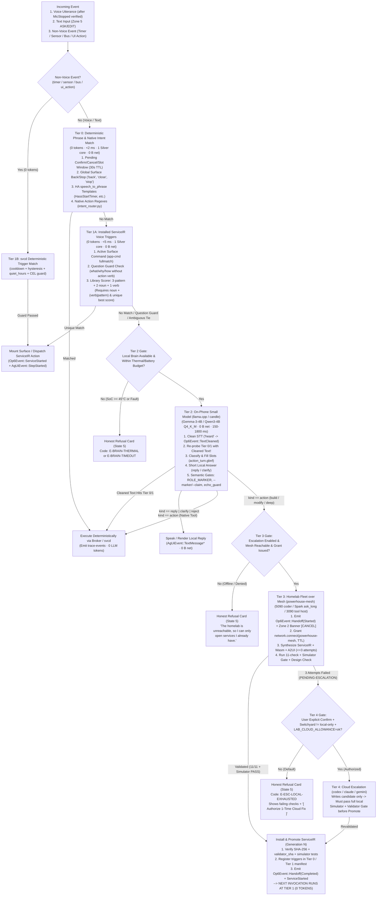
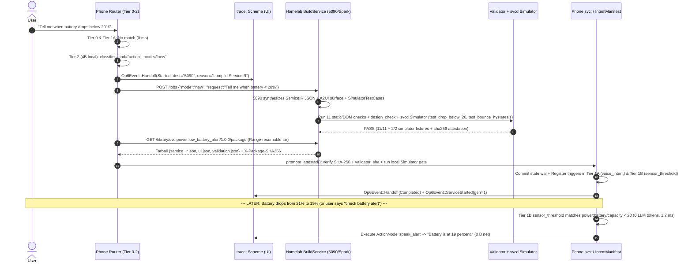

# Intent Routing & Model Tiering (`docs/design/ROUTING.md`)

**Task ID:** D4 (Wave 1)  
**Target OS:** Redox OS on OnePlus 6 (SDM845, `enchilada`) — Language-Native Operating Layer (Part B1, B2, B3, B4, B6, B8, B10)  
**Inputs:** `docs/VISION.md` (esp. §§1–8), `docs/PLAN.md`, `docs/design/SERVICE-IR.md`, `docs/design/UX.md`, `crates/trace-events`, the existing postmarketOS voice-app router (`~/Developer/experiments/voice-stack-tryout/scripts/mobile/listen/` — `native/intent_router.py`, `native/broker.py`, `app_matcher.py`, `turn.py`, `listen_fsm.py`, `listen_fsm_app.py`, `triggers/rules.py`, `triggers/engine.py`, `gen/generate_app.py`, `homelab/build_service.py`, `homelab/sync_client.py`, `homelab/escalate.py`, `app_library.py`), and `op6-refs/{ha-intents,ovos-core,goose,hermes-agent}`.  
**License:** MIT (clean-room specification; references `ha-intents` CC-BY-4.0, `ovos-core` Apache-2.0, `goose` Apache-2.0, `hermes-agent` MIT, `ag-ui` MIT, `otel-semconv` Apache-2.0, `llama.cpp` MIT, `candle` MIT/Apache-2.0).

---

## 1. Executive Summary & Architectural Role

In the language-native Redox phone OS (`docs/VISION.md` §§1–8), the user speaks or types into one unified interface, yet **most interactions never wake a language model**. The routing subsystem is a strict, deterministic cost-and-power ladder that resolves every utterance, touch action, or background hardware event at the **lowest capable tier**:

1. **Tier 0 — Deterministic Phrase & Native Intent Match (`0 tokens`, `< 2 ms`, `0 B net`):** Exact control phrases (`back`, `cancel`, `yes`), pending confirmation/slot windows, `ha-intents` `speech_to_phrase` sentence templates (`HassStartTimer`, `HassCancelTimer`, `HassTurnOn`), and deterministic native action regexes (`intent_router.py` style: `directions`, `save_place`, `call`, `message`, `contacts_open`).
2. **Tier 1 — Installed `ServiceIR` Triggers & Active Surface Commands (`0 tokens`, `< 5 ms`, `0 B net`):** Commands scoped to the currently mounted A2UI/OpenUI surface (`app-cmd`), library/installed `ServiceIR` `voice_intent` matchers scored via the `3·pattern + 2·noun + 1·verb` uniqueness rule (`app_matcher.py`), and non-voice standing triggers (`timer_schedule`, `sensor_threshold`, `bus_message`, `ui_action`) evaluated by `svcd`.
3. **Tier 2 — On-Phone Small Model (`Gemma-3-4B` / `Qwen3-4B` via `llama.cpp` or `candle`, `0 B net`):** Resident or demand-loaded local weights on SDM845 (`150–1800 ms`, `100% offline`). Performs STT disfluency cleanup (`heard` / `TextCleaned`), ambiguous intent classification, slot filling under GBNF grammar constraints (`action_turn.gbnf`), and concise direct answers (`reply` / `clarify`) guarded by the verbatim semantic/claim gates from `turn.py`.
4. **Tier 3 — Homelab Fleet over Mesh (`5090`, `Spark`, `3090` via LiteLLM `:4000` / `build_service.py`):** Invoked **only** when Tier 2 classifies an intent as requiring new/modified `ServiceIR` synthesis (`kind: "action"`, `task_type: "build" | "modify"`), deep multi-step reasoning, or homelab data. Explicitly announced on Zone 2 (`Op6Event::Handoff`), gated by an expiring `network.connect` capability grant, and user-cancellable at any millisecond.
5. **Tier 4 — Cloud Escalation (`codex` / `claude` / `gemini` via `escalate.py`):** Strictly off by default (`local-only` switchyard policy). Reached **only** after `>= 3` validated local homelab synthesis failures (`PENDING-ESCALATION`) **and** explicit operator confirmation + verified `LAB_CLOUD_ALLOWANCE=ok`.

**The Compile-Once Flywheel (`Tier 3/4 → Tier 1 → Tier 0`):** Whenever Tier 3 (or Tier 4) synthesizes or patches an app or routine, it packages the result as a content-addressed, simulator-verified `ServiceIR` bundle (`triggers`, `actions` DAG, `ui`, `power_budget`, `tests`) and installs it into the phone's `svc:` / `state:` registry. The **very next time** the user says that request—or when its sensor/timer trigger fires—it hits **Tier 1 (or Tier 0)** in `< 5 ms` using **0 LLM tokens** and **0 network bytes**.

### 1.1 Borrowed Patterns & Upstream Attribution

| Subsystem | Borrowed Concept | Citation (`repo/path`) | License |
|---|---|---|---|
| **Mic-Close-Before-Route Invariant** | Routing (`_route_action`) only executes after `SAVE` + `PAUSE` + hardware-verified `verify_mic(expect="closed")` (`E-MIC-CLOSE-UNVERIFIED` on failure); echo-drop (`echo_similar >= min_sim`) and wake refractory window | `voice-stack-tryout/scripts/mobile/listen/listen_fsm.py`, `listen_fsm_app.py`, `wake_gate.py` | MIT (internal baseline) |
| **Deterministic Native Intent Router** | Stateful 30 s `pending` confirmation token (`issue_confirmation`, `transaction_id`) and `pending_address` slot-fill window; ordered regex classification (`confirm`, `cancel`, `automation`, `build new app`, `modify app`, `save_place`, `place_directions`, `directions`, `map`, `call`, `message`) | `voice-stack-tryout/scripts/mobile/listen/native/intent_router.py`, `native/broker.py` | MIT (internal baseline) |
| **Mini-App & Library Scorer (`Router v1`)** | 4-step deterministic order (`1 back` → `2 app-cmd` → `3 app-open` → `4 gemma`); hyphenated number compaction (`twenty five` → `twenty-five`, `half` unit resolution); question guard (`QUESTION_STARTERS` minus `GUARD_EXEMPT_VERBS`); `score = 3·pattern + 2·noun + 1·verb` requiring `noun AND (verb OR pattern)` and unique best (`ambiguous` tie falls through to Tier 2) | `voice-stack-tryout/scripts/mobile/listen/app_matcher.py` | MIT (internal baseline) |
| **On-Phone Brain Turn & Semantic Gates** | `normalize_for_brain` punctuation stabilizer; GBNF grammar injection adding `"heard"` field for STT cleanup; decoder ladder (`chain.txt`) with `TERMINAL_FINISH = ("stop", "eos")` honesty; `ROLE_MARKER_RE` check; `intent_semantics.py` `--marker` & `--claim` gate (`claim-without-receipt` refusal); echo guard on `clarify` | `voice-stack-tryout/scripts/mobile/listen/turn.py` | MIT (internal baseline) |
| **Homelab Generation Hub & Attested Sync** | Task routing (`coder` → `5090` for new, `ask_long` → `Spark` for modify `> 32 KB`, `3090` for bounded); 3-attempt validation feedback loop; SHA-256 tar package transfer with HTTP `Range` resume; `promote_attested` verifying `validator_sha` and `design_sha` + ` ledger.jsonl` (`PROMOTE`/`ROLLBACK`/`REJECT`); 3-failure `escalation.json` gate | `voice-stack-tryout/scripts/mobile/listen/gen/generate_app.py`, `homelab/build_service.py`, `homelab/sync_client.py`, `homelab/escalate.py`, `app_library.py` | MIT (internal baseline) |
| **Zero-LLM Sentence Templates & Slots** | Domain/intent/slot schemas (`HassStartTimer`, `HassCancelTimer`, `HassTurnOn`), `slot_combinations`, and `speech_to_phrase: true` lean sentence templates | `op6-refs/ha-intents/intents.yaml`, `sentences/en/HassStartTimer/minutes_only.yaml` | CC-BY-4.0 (attribution required) |
| **Confidence Pipeline & Session Isolation** | Ordered matcher pipeline (`stop_high` → `converse` → `padacioso`/`adapt`high → medium → low → `fallback`); `RESERVED_INTENT_NAMES`; quintuple `IntentManifest` `(session_id, skill_id, intent_name, lang, method)`; `DEFAULT_MATCH_TIMEOUT = 10s` & isolated worker pools (`DEFAULT_MATCH_WORKERS = 4`); `IntentDispatcher` `start`/`complete`/`error` trio | `op6-refs/ovos-core/ovos_core/intent_services/service.py`, `manifest.py`, `dispatcher.py`, `fallback_service.py`, `working_session.py` | Apache-2.0 |
| **Typed Recipe & Sub-Recipe Packaging** | Versioned `Recipe` manifest, `parameters` (`required`/`optional`/`user_prompt`), `sub_recipes` (`sequential_when_repeated`), `response.json_schema`, `RetryConfig` | `op6-refs/goose/crates/goose/src/recipe/mod.rs`, `validate_recipe.rs` | Apache-2.0 |
| **Unreachable Retry & Quota Hold Guards** | Spend-neutral unreachable retry ladder (`5m, 15m, 30m` only when `session_api_calls == 0`); provider `quota_hold_until` parking (`HOLD_SLACK_SECONDS = 60`); advance-before-dispatch recurring execution state machine | `op6-refs/hermes-agent/cron/unreachable_retry.py`, `cron/quota_hold.py`, `cron/scheduler_tick.py` | MIT |

---

## 2. The Five-Tier Routing Ladder



### 2.1 Master Tier Comparison Table (Latency, Power, Compute, Network)

| Tier | Name & Engine | Typical / Max Latency | CPU / Memory / Hardware Footprint | Network Egress | Token Cost | Failure / Fallback Behavior |
|---|---|---|---|---|---|---|
| **Tier 0** | **Deterministic Phrase & Native Intent Match** (`ha-intents` + `intent_router.py` FST/regex) | `0.2–2.0 ms` (hard cap `5 ms`) | `1× Kryo 385 Silver` (`1.76 GHz`), `< 512 KiB` RAM, `0` Wasm fuel | `0 B` (strictly offline) | `0` tokens | Falls through immediately to Tier 1A on `no-match`. |
| **Tier 1A** | **Installed `ServiceIR` Voice Matcher** (`app_matcher.py` + `ovos` `IntentManifest`) | `0.5–5.0 ms` (hard cap `15 ms`) | `1× Kryo 385 Silver`, `< 2 MiB` index RAM | `0 B` (strictly offline) | `0` tokens | Falls through to Tier 2 on `no-match`, `question-guard`, or `ambiguous` score tie. |
| **Tier 1B** | **Installed `ServiceIR` Event/Timer/Sensor Trigger** (`svcd` + `triggers/engine.py`) | `1.0–10.0 ms` (hard cap `50 ms`) | `1× Kryo 385 Silver`, `1–8 MiB` per `ServiceIR.power_budget`, bounded `wasmi` fuel | `0 B` default (unless service holds explicit grant) | `0` tokens | Suppresses on `cooldown_ms`, `hysteresis_reset`, or `quiet_hours`; logs `RunError` if action times out. |
| **Tier 2** | **On-Phone Small LLM** (`Gemma-3-4B` or `Qwen3-4B` Q4_K_M via `llama.cpp` / `candle`) | TTFC `150–400 ms`; total `0.5–3.5 s` (hard cap `turn_cap_s = 15 s` interactive, `30 s` cold load) | `4× Kryo 385 Gold` burst (`2.8 GHz`) + `2× Silver`, `2.2–2.8 GiB` mmap weights, `WakeLockAcquired` (`max_us = 30_000_000`) | `0 B` (loopback IPC / in-process only) | `150–600` in, `20–120` out (local, $0) | If `kind == "action"` requires synthesis → Tier 3; if decoder chain fails → honest `E-BRAIN` refusal (never invents default text). |
| **Tier 3** | **Homelab Fleet over Mesh** (`5090` fast coder, `Spark` long-ctx, `3090` tool/voice via `:4000` / `:18774`) | Mesh RTT `15–45 ms`; chat TTFC `80–250 ms`; full `ServiceIR` build+verify `4–35 s` (hard cap `esc_cap_s = 180 s`) | Phone: `1× Silver` + Wi-Fi (`wcn3990`) or USB `CDC-NCM`, `< 4 MiB` RAM; Homelab GPU carries inference | `1–32 KiB` up, `4–128 KiB` down (`network.connect` grant to `powerhouse-mesh`) | Local fleet GPU ($0 cloud spend) | If mesh down → immediate `UNREACHABLE` refusal + `hermes` unreachable retry state for background jobs; if 3 build attempts fail → `PENDING-ESCALATION`. |
| **Tier 4** | **User-Authorized Cloud Escalation** (`cloud-dispatch.sh` via `escalate.py`) | `10–90 s` (hard cap `300 s`) | Phone: `1× Silver`, `< 4 MiB` RAM | `2–64 KiB` (via homelab relay or explicit cloud grant) | Included allowance only (`LAB_CLOUD_ALLOWANCE=ok`, $0 overage) | Disabled unless user confirms card AND switchyard allows cloud; candidate still must pass local validator before install. |

---

## 3. Pre-Routing Invariant: Mic-Close & Echo Gate (`listen_fsm.py`)

Before any voice utterance enters Tier 0, the router enforces two hardware-verified invariants inherited from `voice-stack-tryout/scripts/mobile/listen/listen_fsm.py` (`§§B.2, B.5, B.7` & `AMENDED 8:55`):

1. **Echo Suppression (`echo_window` + `echo_similar`):**
   * While within `echo_window_s` after TTS playback (`SPEAKING`), incoming STT segments whose token similarity to `last_spoken` meets or exceeds `cfg.echo.min_sim` are dropped before wake/intent matching and logged on `trace:` (`ECHO-DROPPED`).
2. **Hardware-Verified Mic Closure Before Routing (`verify_mic(expect="closed")`):**
   * Once an utterance is finalized (`_finalize`), the state machine saves the audio receipt (`SAVE <turn_id>`), pauses capture (`PAUSE`), and queries the audio scheme (`verify_mic("closed")`) with deadline `mic_verify_timeout_s`.
   * **Routing (`_route_action`) never begins until `Op6Event::MicStopped` is corroborated by the audio scheme (`streams 0`).** If the first close check fails, the supervisor issues `QUIT` + `kill_hop` and retries once; if still open, it halts in `ERROR` with code `E-MIC-CLOSE-UNVERIFIED` (`listen_fsm.py:204-218`).

---

## 4. Decision Rules Per Tier

### 4.1 Tier 0 — Deterministic Phrase & Native Intent Match (`0 tokens`)

Tier 0 is a pure, zero-I/O, deterministic function `route_tier0(text, session_state, active_surface) -> Option<Tier0Match>` executing in `< 2 ms` on a single Kryo 385 Silver core. It evaluates in four strict sub-stages:

#### Stage 0.1: Stateful Confirmation & Slot-Fill Windows (`intent_router.py:89-116`, `triggers/engine.py:73-110`)
If the router holds an active `pending_confirmation` or `pending_slot` window (default TTL `30 s` monotonic clock):
* **Expiration Check:** If `clock_monotonic_us() >= pending.expires_us`, the router invalidates the confirmation token in the capability broker (`broker.invalidate_confirmation()`), clears `pending`, and if the user just said a confirm/cancel word, immediately speaks `"That confirmation timed out."` (`status: "cancelled"`).
* **Cancel Words (`"no"`, `"nope"`, `"cancel"`, `"never mind"`, `"stop"`):** Invalidates `pending` and `pending_slot`, emits `AgUiEvent::RunFinished { outcome: Cancelled }`, and replies `"Cancelled."`.
* **Confirm Words (`"yes"`, `"yeah"`, `"yep"`, `"confirm"`, `"apply"`):**
  * If `pending` is `None`: returns `"There is nothing to confirm."` (`0 tokens`).
  * If `pending` is valid: consumes `pending.transaction_id` (one-time CSPRNG token from `broker.issue_confirmation`) and dispatches the pre-validated action (`call`, `message`, `apply_generation`, or `allow_cloud_escalation`).
* **Pending Slot Window (`pending_slot`, e.g., `need-address` from `save_place` or `car-where-to` trigger):**
  * Binds the utterance directly to the missing slot (e.g., `save_place(name=pending_name, address=text)`), bypassing LLM parsing.

#### Stage 0.2: Global Surface & Audio Control Phrases (`app_matcher.py:51-54`, `ovos-core/stop_service.py`)
* **Back / Dismiss (`BACK_PHRASES`):** Exact normalized match against `{"back", "go back", "close", "close it", "close the app", "exit", "home", "done"}`:
  * If a UI surface is currently mounted (`focused_surface_id != None`): returns `Tier0Match::CloseSurface { surface_id, reason: "back" }`.
  * If no surface is open (`back-no-app`): does **not** close anything; records `reason: "back-no-app"` and falls through.
* **Targeted vs. Global Stop (`"stop"`, `"quiet"`, `"shut up"`, `"pause"`):**
  * Borrowed from `ovos-core/intent_services/stop_service.py` (`PreDrainSnapshot`): if TTS playback (`SPEAKING`) or an active `ServiceIR` alert is firing, stops the active stream/handler immediately (`0 tokens`).

#### Stage 0.3: Home Assistant `speech_to_phrase` Sentence Templates (`op6-refs/ha-intents`)
Compiled finite-state template matchers loaded from the system's built-in `ha-intents` subset (`speech_to_phrase: true`, CC-BY-4.0 attributed):
* Number tokens are normalized and hyphen-compacted first using `app_matcher.py:101-129` (`"twenty five"` → `"twenty-five"`, `"a"` / `"an"` → `1`, `"half"` → unit-resolved `30 s` or `0.5`).
* Matches core OS intents with deterministic slot extraction:
  * `HassStartTimer`: e.g., `"set a timer for {minutes} minutes"`, `"{minutes} minute timer"`, `"timer for half an hour"` → `slots: { duration_sec: 1800 }` → dispatches `svc.timer.countdown`.
  * `HassCancelTimer` / `HassPauseTimer` / `HassResumeTimer` / `HassTimerStatus`.
  * `HassTurnOn` / `HassTurnOff` / `HassSetVolume` / `HassSetBrightness` for local hardware schemes (`audio:`, `display:brightness`, `automations`).

#### Stage 0.4: Native OS Action Regexes (`intent_router.py:27-77`)
Evaluated in exact priority order from `native/intent_router.py`:
1. **Automation toggles:** `^(turn (?:on|off)|enable|disable) automations?\b` → `automation(operation="settings")`.
2. **Saved places & offline navigation:**
   * `^(?:save|remember) (.+?) (?:address (?:is|as)|at|is) (.+)$` → `native_action(action="save_place", name, address)`
   * `^(?:save|remember) (.+?) address$` → `native_action(action="save_place", name)` (opens `need-address` slot window)
   * `^(?:going to|go to|navigate to) (.+)$` → `native_action(action="place_directions", name)` (resolves place in `state:places`; if found, launches `svc.nav.offline_route`; if unknown, opens `need-address` window)
   * `^(?:directions to|show directions to|route to) (.+?)(?: from (.+))?$` → `native_action(action="directions", destination, start)`
   * `^(?:where is|where's) (.+)$` or `^(?:show (?:me )?(?:a |the )?map|open maps?)(?: (?:of|for) (.+))?$` → `native_action(action="map", query)`
3. **Browser & Lookup:**
   * `^(?:open (?:url |website )?)(https?://\S+|[\w.-]+\.[a-z]{2,}\S*)$` → `native_action(action="browser_open", url)`
   * `^(?:search (?:for )?|look up )(.+)$` → `native_action(action="browser_search", query)`
4. **Sensitive Communication Actions (Gated by Capability + Confirmation Token):**
   * `^call (?:number )?(.+)$` → checks `caps:` for `modem:voice` (`sim`). If blocked (no SIM / driver disabled on boot), immediately emits **State 5 Honest Refusal Card** (`"I can't place calls here yet: modem:voice is unavailable"`). If available, issues a 30 s `transaction_id` confirmation token and asks `"Please say yes to confirm call for <recipient>, or no to cancel."`
   * `^(?:(matrix|sms) )?(?:message|text) (.+?)\s+(?:saying |that |: )(.+)$` → checks `sms` or `matrix` capability; requires 30 s confirmation token before dispatch.
5. **Explicit Build / Modify Directives (Fast-Fail to Tier 2/3 Intent Tagging):**
   * `^(build|create|make) (?:me )?(?:a |an )?(?:new )?(?:app|skill|service|routine)\b` → tags `intent_hint = "build_new_service"` (skips Tier 1 library open so a request to *build* a timer app doesn't accidentally just open the existing timer).
   * `^(modify|change|update|edit)\b` or `^(when |whenever |automate |create an automation\b)` → tags `intent_hint = "modify_or_automate"`.

---

### 4.2 Tier 1 — Installed `ServiceIR` Triggers (`0 tokens`)

When Tier 0 does not match (and did not tag `build_new_service` / `modify_or_automate`), the router evaluates **Tier 1** in `< 5 ms` with **0 LLM tokens**.

#### Tier 1A: Voice & Text Matching Against Installed `ServiceIR` Packages (`app_matcher.py` + `ovos` `IntentManifest`)

Every installed `ServiceIR` package registers its `triggers[kind="voice_intent"]` entries into the in-memory `IntentManifest` keyed by `(session_id, service_id, intent_name, lang, method)` (`ovos-core/intent_services/manifest.py:98`). Reserved names `{"converse", "response", "stop", "fallback", "common_query"}` are rejected at registration time (`manifest.py:28`).

Tier 1A executes the exact 3-step algorithm proven in `app_matcher.py:317-382`:

1. **Active Surface Command Match (`route == "app-cmd"`, score `3`):**
   * If a `ServiceIR` UI surface is currently open (`app_open_id != None`), the router tests the normalized, number-compacted text against every `voice_intent` pattern and `commands[].patterns` of **that open service first** using unanchored `fullmatch` (`_compile` strips leading `^` / trailing `$` and requires full-string match so prefix accidents cannot fire).
   * Every declared slot (`number`, `enum:a|b|c`, `duration`, `text`) is parsed via `_parse_args`. If a regex matches but a slot fails type parsing (e.g., `"set a timer for purple minutes"` where `parse_number("purple") == None`), the match is **rejected** (`app_matcher.py:217-233`).
   * On match: dispatches directly to the open service's `entry_action` (`score: 3, reason: "app-cmd"`).

2. **Question Guard (`reason == "question-guard"`):**
   * Before scanning the installed library to open a service, the router checks `_question_guard(tokens)` (`app_matcher.py:184-189`):
   * If `tokens[0]` is in `QUESTION_STARTERS` (`{"what", "why", "how", "who", "when", "where", "which", "is", "are", "does", "do", "can"}`) **and** the utterance contains none of `GUARD_EXEMPT_VERBS` (`{"open", "show", "start", "launch", "build", "make", "create"}`), Tier 1A immediately declines with `reason: "question-guard"` and routes to **Tier 2** so questions like *"Why is my timer loud?"* or *"How much water should I drink?"* get answered rather than blindly launching an app.

3. **Installed Library Scoring (`route == "app-open"`):**
   * For every installed `ServiceIR` in the registry, the router evaluates:
     * `has_noun`: any token sequence in `utterances.nouns` appears in `tokens` (`+2` points).
     * `has_verb`: any token sequence in `utterances.verbs` appears in `tokens` (`+1` point).
     * `has_pattern`: any `voice_intent` / command pattern in the service `fullmatch`es `norm` with valid parsed slots (`+3` points).
   * **Inclusion Gate:** A service is a candidate **if and only if** `has_noun AND (has_verb OR has_pattern)` (`app_matcher.py:359-360`), OR its `ha-intents`-style `voice_intent.sentences` template `fullmatch`es `norm`.
   * **Score Formula:**
     $$\text{score} = 3 \cdot \mathbb{I}(\text{pattern}) + 2 \cdot \mathbb{I}(\text{noun}) + 1 \cdot \mathbb{I}(\text{verb}) \in \{3, 5, 6\}$$
   * **Uniqueness Rule:**
     * If `hits` is empty → falls through to Tier 2 with `reason: "no-match"`.
     * Let `best = max(h.score for h in hits)` and `tied = [h for h in hits if h.score == best]`.
     * If `len(tied) > 1` → **never guesses**; falls through to Tier 2 with `reason: "ambiguous", tied: sorted(ids)` so the on-phone model can disambiguate or ask the user.
     * If `len(tied) == 1` → returns `route: "app-open", id: hit.id, cmd: hit.cmd, args: hit.args, score: hit.score, reason: "library-hit"`. If `hit.cmd` is present, the service both mounts its surface **and** executes `hit.cmd` as its initial action in one transaction.

#### Tier 1B: Non-Voice `ServiceIR` Triggers (`svcd` + `triggers/engine.py`)
Hardware, timer, and bus events (`sensor_threshold`, `timer_schedule`, `bus_message`, `ui_action`) route directly to `svcd` at Tier 1B with **0 LLM tokens**:
* **Hysteresis & Edge-Only Guard (`SERVICE-IR.md` §2.1):** A `sensor_threshold` trigger (e.g., `power:battery/capacity < 20`) fires once on the downward edge and cannot re-arm until the reading crosses `hysteresis_reset` (`>= 23%`).
* **Cooldown & Daily Cap (`triggers/engine.py:58-65`):** Enforces `cooldown_ms` and `max_per_day` per `(service_id, trigger_id)`.
* **Quiet Hours Guard (`triggers/engine.py:18-24, 67-69`):** If the trigger fires inside `quiet_hours` (e.g., `21:00–05:00` local timezone) and `priority_class != P0_SAFETY_THERMAL`, execution is deferred (`status: "deferred", reason: "quiet-hours"`) without waking TTS or display.
* **Advance-Before-Dispatch (`hermes-agent/cron/scheduler_tick.py`):** Recurring `timer_schedule` triggers advance `next_run_at` to the next future slot before dispatching the DAG, guaranteeing at-most-once execution across reboots.

---

### 4.3 Tier 2 — On-Phone Small Model (`llama.cpp` / `candle`, `0 B net`)

When an utterance misses Tier 0 and Tier 1 (or hits `question-guard`, `ambiguous`, or `modify_or_automate`), the router invokes **Tier 2**: the on-phone language model (`Gemma-3-4B-IT` or `Qwen3-4B` Q4_K_M GGUF served by local `llama-server` on `127.0.0.1:8080` or in-process `candle`/`llama.cpp` scheme).

#### 4.3.1 What the On-Phone Model MUST Do
1. **Clean STT Disfluencies & Re-Probe Tier 0/1 (`"heard"` → `Op6Event::TextCleaned`):**
   * Speech recognition often produces prefixes, filler words, or split numbers (e.g., `"okay gemma um set a timer foruh ten minutes"`).
   * Following `turn.py:284-290`, the GBNF grammar (`action_turn.gbnf`) mandates a `"heard"` field containing the normalized wording while preserving names, numbers, and intent.
   * **Fast Re-Probe Rule:** As soon as `TextCleaned { raw, cleaned }` is extracted, if `cleaned != raw`, the router **re-runs Tier 0 and Tier 1A on `cleaned`** (`< 2 ms`). If `cleaned` matches an existing Tier 0/1 intent, the router dispatches it deterministically right away!
2. **Classify Intent & Fill Typed Slots Under Grammar Constraints (`action_turn.gbnf`):**
   * Emits a strict JSON object conforming to `voice_chat.json` / `action_turn.gbnf`:
     ```json
     {
       "heard": "Remind me to stretch every 45 minutes",
       "kind": "action",
       "tool": "svc_compile_or_route",
       "args": {
         "mode": "new",
         "task_kind": "bounded",
         "summary": "Standing timer routine every 45 minutes to stretch"
       },
       "say": "I'll build a 45-minute stretch reminder routine on the homelab."
     }
     ```
   * Resolves `ambiguous` Tier 1 ties by selecting among the `tied` `service_id` candidates using conversational context (`working_session.py`).
   * Extracts structured slots when natural phrasing falls outside Tier 0/1 templates (e.g., *"wake me up twenty minutes before seven"* → `HassStartTimer` / alarm slot `06:40`).
3. **Answer Simple Local Questions & Clarify Ambiguity (`kind: "reply" | "clarify"`):**
   * Answers general knowledge, math, unit conversions, and device-state questions (reading injected visible context from `UX.md` §4.1: battery %, active timers, open surface state) in 1–3 concise spoken sentences.
   * When a request is underspecified, emits `kind: "clarify"` with a specific question (guarded by the **Echo Guard** in `turn.py:408-414`: if `_norm(say) == _norm(brain_text)`, it replaces the parrot response with `"I'm not sure how to answer that. Try asking it another way."`).

#### 4.3.2 What the On-Phone Model MUST NEVER Do
1. **NEVER execute on every recurring trigger, timer tick, or sensor sample (`VISION.md` §8, `SERVICE-IR.md` §1):** Standing rules and active mini-apps run 100% deterministically in `svcd` (Tier 1B).
2. **NEVER claim an action succeeded without a broker/executor receipt (`turn.py:346-352, 433-436`):**
   * Every Tier 2 completion passes through `intent_semantics.py --marker` and `--claim`.
   * If `marker == "no"` and `claim == "yes"` (the model hallucinated *"I have sent the text"* or *"I set your timer"* in plain prose without emitting a valid broker tool call), Tier 2 **refuses the output** with `error: "claim-without-receipt"` and speaks `GENERIC_CLARIFY` (`"I could not understand that request correctly, so I did nothing. Please rephrase it."`).
3. **NEVER synthesize full Wasm binaries or complex multi-component apps on the phone CPU:**
   * Generating, compiling, and running 11-check headless validation of new multi-kb `ServiceIR` / Wasm / UI packages on SDM845 drains battery and takes 40–120+ seconds. Whenever `kind == "action"` requires `mode: "new"` or `mode: "modify"` (beyond a single scalar parameter tweak on an existing `ServiceIR` generation), Tier 2 routes to **Tier 3 (Homelab)**—or, if offline, returns an honest refusal (`UNREACHABLE`).
4. **NEVER launder truncated or broken generations (`turn.py:314-336`):**
   * A generation is usable **only** when `content.strip() != ""` **and** `finish_reason in ("stop", "eos")`. `finish_reason == "length"` or `"?"` is discarded immediately.
   * Any reply matching `ROLE_MARKER_RE` (`(^|[^A-Za-z])(user|assistant)\s*:`) is rejected with `error: "role-marker"` (broken chat template guard).
5. **NEVER access raw schemes, filesystems, or network sockets directly:** The Tier 2 inference process runs inside a sandbox with zero network capability (`allowed_hosts: []`) and communicates only via the turn broker pipe.

---

### 4.4 Tier 3 — Homelab Models Over the Mesh (`powerhouse-mesh`, Announced & Cancellable)

When Tier 2 outputs `kind: "action"` requiring code/service synthesis (`build_new_service`, `modify_service`), or when the user asks for deep research / long-context analysis that exceeds the 4B on-phone model, the router transitions to **Tier 3 (`ESCALATING` state in `listen_fsm_app.py:44-52`)**.

#### 4.4.1 Pre-Flight Gates & Open-Kimono Announcement
1. **Policy & Switch Check:** Checks `cfg.escalation.enabled` and the Rescue Console's hardware network switch (`UX.md` §5.2). If disabled, speaks `msgs.escalation_disabled` (`0 B net`).
2. **Capability Grant (`caps:`):** Requests a scoped, expiring grant:
   * `capability: "network.connect"`, `scope: "powerhouse-mesh:18774"` (for `build_service.py`) or `"powerhouse-mesh:4000"` (LiteLLM gateway), `expires_us: now + 180_000_000`.
   * Emits `Op6Event::GrantGranted` → Zone 1 `NET:` indicator turns `#FF6B00` (`NET: ↑ ... · powerhouse-mesh`).
3. **Mandatory Announcement & Cancellation Hook (`VISION.md` §5, `UX.md` §2.6):**
   * Before the first TCP/HTTP packet leaves the phone, the router emits:
     ```json
     {"kind":"op6","type":"handoff","destination":"5090 (powerhouse-mesh:18774)","reason":"compile new ServiceIR: svc.health.water_tracker","status":"started"}
     ```
   * Zone 2 expands the orange Hand-Off Banner with a live `[ CANCEL ]` button; speaking `"cancel"` or `"stop"` (Tier 0) or tapping `[ CANCEL ]` immediately triggers `escalate_kill`, revokes the `network.connect` grant, and emits `Op6Event::Handoff { status: Failed, reason: "cancelled by user" }`.
4. **Phone Brain Suspend (`brain_stop`):** While waiting on the homelab (`listen_fsm_app.py:47`), the phone pauses/unloads active Tier 2 compute threads and releases Gold CPU cores so the phone stays cool (`1 Silver core` polling job status).

#### 4.4.2 Homelab Lane Selection (`build_service.py:41-51` & `generate_app.py:74-76`)
On the homelab side, `build_service.py` and `inference_client.py` route the job to the optimal local GPU lane without hardcoding ephemeral model filenames:
* **`5090` (`task="coder"` — Primary Fast Coding Lane):** Default for `mode == "new"` `ServiceIR` + A2UI/OpenUI + Wasm synthesis and fast edits (`<= 32 KiB` context).
* **`Spark` (`task="ask_long"` — Large-Context / Agentic Lane):** Selected when `mode == "modify"` and the base package or context exceeds `large_kb = 32 KiB`, or for deep multi-document research.
* **`3090` (`task_kind="bounded"` / Wyoming Speech & Tool Host):** Selected for bounded mechanical transformations (`<= 3090` tool host) and remote Wyoming STT/TTS streaming (`apps/voice-bridge`, Task C5) while SDM845 audio drivers (Part A14) are in bring-up.

#### 4.4.3 Unreachable Mesh & Quota-Hold Behavior (`sync_client.py` + `hermes-agent/cron`)
* **Interactive Voice/Text Request:** If `SyncClient.submit()` fails with `URLError` / `TimeoutError` (`timeout = 5.0 s`), the router **never hangs**. It immediately emits `Op6Event::Handoff { status: Failed, reason: "mesh unreachable" }`, revokes `network.connect`, and renders **State 5 Honest Refusal**:
  > *"The homelab is unreachable, so I can only open services I already have."* (`sync_client.py:23`)
* **Deferred Background / Scheduled Synthesis (`hermes-agent/cron/unreachable_retry.py` & `quota_hold.py`):**
  * If the user selects `[ Queue for when Homelab Mesh Reconnects ]` on the Refusal Card, the job is parked under `hermes-agent`'s spend-neutral `unreachable_retry` ladder (`RETRY_DELAYS_SECONDS = (300, 900, 1800)` — 5m, 15m, 30m, `unreachable_retry.py:33`), firing only when mesh presence (`powerhouse-mesh` ping) returns and `session_api_calls == 0`.
  * If a provider returns a rate-limit window (`retry after <N>s`), `quota_hold.py` (`HOLD_SLACK_SECONDS = 60`) parks `next_run_at` past the window boundary rather than burning battery on doomed retries.

---

### 4.5 Tier 4 — Cloud Escalation (User-Permitted Only, `escalate.py`)

Cloud tokens are **never** spent automatically (`VISION.md` §5, §8 & fleet cost-routing policy). Tier 4 is guarded by a triple lock implemented in `homelab/escalate.py`:

1. **Gate 1 — Exhausted Local Attempts (`len(failures) >= 3`):**
   * `generate_app.py` must have completed all `DEFAULT_ATTEMPTS = 3` local generation + validation cycles (feeding exact failing check lines back into each retry, `generate_app.py:350-360`) and written `escalation.json` with `"state": "PENDING-ESCALATION"`.
2. **Gate 2 — Switchyard & Allowance Verification (`escalate.py:18-35`):**
   * Checks `switchyard-ctl mode` (must not be `local-only`) and `~/.config/lab-cloud-allowance.env` (must contain `LAB_CLOUD_ALLOWANCE=ok`).
3. **Gate 3 — Explicit User Confirmation on the Phone (`AgUiEvent::RunFinished { outcome: Interrupt }`):**
   * The phone displays an explicit confirmation card naming the cloud provider, the reason local lanes failed (e.g., `check 7 SimulatorTestCase failed 3/3 times on 5090`), and requires the user to tap `[ Authorize 1-Time Cloud Escalation ]` or say `"yes"`.
4. **No Direct Promotion Authority (`escalate.py:49-50, 55-72`):**
   * Even when authorized, the cloud worker (`cloud-dispatch.sh --tool codex,cursor,local`) is instructed: *"Write candidate files only. Do not promote."*
   * `escalate.py:revalidate()` re-runs the full local validation suite (`validate_app.mjs`, `design_check.mjs`, and `svcd` simulator tests) and verifies `validator_sha` before the package can be promoted and sent to the phone.

---

## 5. The Compile-Back Loop: How Homelab-Built Services Become Tier 0 / Tier 1

A core architectural invariant of this OS is that **LLM synthesis is an investment that amortizes to zero**: once a user asks to build or modify a tool, routine, or mini-app, the resulting artifact is installed locally as a deterministic `ServiceIR` package so subsequent uses execute at **Tier 1 (`< 5 ms`, `0 tokens`, `0 B net`)** or **Tier 0**.



### 5.1 Step-by-Step Promotion & Registration Pipeline

1. **Synthesis Contract on the Homelab (`generate_app.py` / `SERVICE-IR.md` §2.1):**
   * When `5090` (or `Spark`) compiles a request, it must emit a complete `ServiceIR` package containing:
     * **`triggers`:** Both the standing hardware/timer triggers (`sensor_threshold`, `timer_schedule`, `bus_message`) **and** rich `voice_intent` patterns + `utterances: { nouns: [...], verbs: [...] }` + `ha-intents`-compatible sentence templates so future voice commands hit Tier 0 / Tier 1A.
     * **`actions`:** Deterministic DAG (`state_mutate`, `dialog`, `ui_patch`, `wasm_call`, `bus_emit`) with `effect_class` and `idempotency_key_template`.
     * **`power_budget`:** Explicit ceilings (`cpu_cluster_preference: "silver_only"`, `network_egress_bytes_max: 0`, `memory_limit_mb`).
     * **`tests`:** At least one positive and one negative/edge `SimulatorTestCase` (e.g., hysteresis bounce test or invalid slot test).
2. **Host Validation & Attestation (`build_service.py:138-170`):**
   * The homelab runs the 11-check gate (`validate_app.mjs`), the black+orange visual contract check (`design_check.mjs`), and the deterministic `svcd` simulator (`svc:simulate`, Task B4).
   * If any check fails, the exact failure lines are fed back into attempt `k+1` (up to 3 attempts).
   * On pass, `build_service.py` seals a tarball containing `{service_ir.json (or skill.json + index.html), validation.json}` signed with `X-Package-SHA256`, `validator_sha`, `design_sha`, and `base_css_sha`.
3. **Resumable Download & Phone-Side Re-Verification (`sync_client.py:72-137`, `app_library.py:413-476`):**
   * The phone downloads `/library/<id>/<version>/package` with HTTP `Range: bytes=<offset>-` support and exponential backoff (`1s, 2s, 4s, 8s`) over the mesh.
   * Before promotion, `promote_attested()` on the phone independently:
     1. Verifies the package SHA-256 and checks that `validator_sha` and `(design_sha, base_css_sha)` match the phone's pinned trusted SHA set (`pinned_validator_shas`).
     2. Runs `scan_dir()` (Checks 2–4: file hashes, size caps `<= 64 KiB` seed / `<= 128 KiB` generated, zero external URLs, zero forbidden tokens like `fetch(`, `eval(`, `WebSocket`).
     3. Executes the embedded `ServiceIR.tests` inside `svcd`'s in-memory simulator (`crates/svcd`) to confirm deterministic pass and `power_budget` compliance on the device itself.
4. **Atomic Generation Switch & Hot Index Registration (`app_library.py:465-476`):**
   * Moves the verified directory atomically into `/scheme/state/skills/<id>/<version>/`.
   * Updates `skills/index.json` (`previous = current`, `current = version`, bumping `generation: N -> N+1`) and appends a `PROMOTE` record to `skills/ledger.jsonl`.
   * Immediately hot-loads the package's `triggers` into:
     * **Tier 0Sentence Table** (if the package declares exact `speech_to_phrase: true` templates),
     * **Tier 1A `IntentManifest`** (`utterances.nouns`, `utterances.verbs`, `commands[].patterns`), and
     * **Tier 1B `svcd` Trigger Watch Table** (`sensor_threshold`, `timer_schedule`, `bus_message`).
5. **Instant Rollback (`app_library.py:488-506`):**
   * If the user says *"undo that"* or *"roll back <service>"* (or taps `[ ↺ Rollback to gen N-1 ]` in Zone 3/4), `rollback_skill()` swaps `current` and `previous` in `index.json`, appends `ROLLBACK` to `ledger.jsonl`, restores the previous generation's trigger table in Tier 0/1, and emits `Op6Event::ServiceStarted { generation: N-1, reason: "user rollback" }` in `< 3 ms` with `0 tokens`.

---

## 6. Open-Kimono Observability: How Every Routing Decision Is Shown (`crates/trace-events`)

Every step of the routing ladder emits typed JSONL records onto the `trace:` scheme (`crates/trace-events`) so the Open-Kimono UI (`docs/design/UX.md` §7) and `apps/timeline` (Task C4) render the exact tier, latency, token usage, hardware power switches, and human-readable `reason`.

### 6.1 Routing Stage → `crates/trace-events` Mapping Table

| Routing Stage / Decision | `Payload` Kind | Exact Variant (`crates/trace-events`) | Required Attributes / Payload Fields | UI Projection (`docs/design/UX.md`) |
|---|---|---|---|---|
| **1. Mic Opens for Utterance** | `Payload::Op6` | `Op6Event::MicStarted { device: Some("wyoming:local") }` | `device` | Zone 1 & Zone 5 ring turns `#FF6B00` `(●) LISTENING`; stream count `streams 1`. |
| **2. Live Audio Level** | `Payload::Op6` | `Op6Event::MicFrame { level }` | `level: 0.0..=1.0` | Drives Zone 5 24-bar orange waveform at 30–60 Hz. |
| **3. Streaming STT Partial** | `Payload::Op6` | `Op6Event::SttPartial { engine, text, confidence }` | `engine: "moonshine-small"`, `text` | Zone 3 card + Zone 5 dock preview with orange cursor `▍`. |
| **4. Final Raw STT** | `Payload::Op6` | `Op6Event::SttFinal { engine, text, confidence, latency_us }` | `engine`, `text`, `confidence`, `latency_us` | Locks raw transcript and displays `[stt: moonshine-small · 138ms]`. |
| **5. Verified Mic Close Before Route** | `Payload::Op6` | `Op6Event::MicStopped { reason: "utterance complete (verified closed)" }` | `reason` (mandatory, never silent) | Zone 1 & 5 ring turns grey `(○) OFF`; subtitle shows `mic closed · utterance complete`. |
| **6. Run & Routing Step Start** | `Payload::AgUi` | `AgUiEvent::RunStarted { thread_id, run_id, .. }` + `AgUiEvent::StepStarted { step_name: "route.tier0_1" }` | `thread_id`, `run_id`, `step_name` | Opens utterance routing breadcrumb in Zone 3. |
| **7A. Tier 0 / Tier 1 Fast-Path Hit (`0 tokens`)** | `Payload::AgUi` + `Payload::Op6` | `AgUiEvent::Custom { name: "routing.decision", value: {"tier": 0, "route": "ha_intent", "intent": "HassStartTimer", "slots": {"duration_sec": 600}, "score": 6, "tokens": 0, "latency_us": 1420, "reason": "speech_to_phrase"} }` → `Op6Event::ServiceStarted { service: "svc.timer.countdown", generation: 1, reason: "voice_intent trig_voice_start" }` | `tier: 0 \| 1`, `route`, `id`/`intent`, `score`, `tokens: 0`, `latency_us`, `reason` | Zone 3 renders **INTENT FAST-PATH (0 LLM tokens · 1.4ms)** card (`UX.md` State 1); Zone 4 adds active service pill. |
| **7B. Tier 1 Miss / Fallthrough to Tier 2** | `Payload::AgUi` | `AgUiEvent::Custom { name: "routing.decision", value: {"tier": 2, "from_tier": 1, "reason": "question-guard" \| "ambiguous" \| "no-match", "tied": [...]} }` | `tier: 2`, `reason`, optional `tied` | Zone 4 trace drawer logs `route -> tier 2 (reason: question-guard)`. |
| **8. Tier 2 Power & Wake-Lock Acquisition** | `Payload::Op6` | `Op6Event::WakeLockAcquired { holder: "tier2.brain", deadline_us, max_us: Some(30_000_000) }` + `Op6Event::PowerChange { component: "cpu.gold_cluster", state: PowerState::On, reason: "tier2 local LLM inference (qwen3-4b)" }` | `holder`, `deadline_us`, `max_us`, `component`, `state`, `reason` | Zone 4 shows decaying wake-lock bar `[wake: tier2.brain · 15s/30s]` and flashes `⚡ cpu.gold_cluster ON`. |
| **9. Tier 2 OTel GenAI Span Start** | `Payload::GenAi` | `GenAiEvent::SpanStart { name: "chat qwen3-4b-q4_k_m", attributes }` (with `span_id`) | `gen_ai.operation.name = "chat"`, `gen_ai.provider.name = "local.llamacpp"`, `gen_ai.request.model = "qwen3-4b-q4_k_m"`, `gen_ai.request.temperature = 0.2`, `gen_ai.request.max_tokens = 256` | Zone 3 opens Reasoning/Model header with live elapsed timer. |
| **10. Tier 2 STT Cleanup (`heard`)** | `Payload::Op6` | `Op6Event::TextCleaned { raw, cleaned }` | `raw`, `cleaned` | Zone 3 promotes bold `cleaned` text and collapses `raw` into muted diff sub-line (`UX.md` §2.2). |
| **11. Tier 2 Reasoning & Output Stream** | `Payload::AgUi` | `AgUiEvent::ReasoningStart` → `ReasoningMessageContent { delta }` → `ReasoningEnd` → `TextMessageStart` → `TextMessageContent { delta }` → `TextMessageEnd` | `message_id`, `role: Assistant`, `delta` | Streams reasoning into orange-bordered block and spoken answer into Zone 3 / Zone 5. |
| **12. Tier 2 OTel GenAI Span End & Power Down** | `Payload::GenAi` + `Payload::Op6` | `GenAiEvent::SpanEnd { name: "chat qwen3-4b-q4_k_m", status: SpanStatus::Ok, attributes }` + `Op6Event::PowerChange { component: "cpu.gold_cluster", state: PowerState::Off, reason: "tier2 turn complete" }` + `Op6Event::WakeLockReleased { holder: "tier2.brain", reason: Some("turn complete") }` | `gen_ai.response.finish_reasons = ["stop"]`, `gen_ai.response.time_to_first_chunk`, `gen_ai.usage.input_tokens`, `gen_ai.usage.output_tokens` | Zone 3 header locks `[TTFC 180ms · in: 194 tok · out: 38 tok]`; Gold cores power off immediately. |
| **13. Tier 3 Homelab Hand-Off Start** | `Payload::Op6` + `Payload::GenAi` | `Op6Event::GrantGranted { service: "router.escalate", capability: "network.connect", scope: Some("powerhouse-mesh:18774"), expires_us }` → `Op6Event::Handoff { destination: "5090 (powerhouse-mesh:18774)", reason: "compile new ServiceIR", status: HandoffStatus::Started }` → `GenAiEvent::SpanStart { name: "invoke_agent homelab-5090-coder", attributes }` | `destination`, `reason`, `status: Started`, `gen_ai.operation.name = "invoke_agent"`, `gen_ai.agent.name = "homelab-5090-coder"` | Zone 1 `NET:` turns `#FF6B00`; Zone 2 mounts orange Hand-Off Banner with RTT and `[ CANCEL ]` (`UX.md` State 2). |
| **14. Tier 3 Validator & Simulator Tool Spans** | `Payload::AgUi` + `Payload::GenAi` | `AgUiEvent::ToolCallStart { tool_call_id, tool_call_name: "simulator.verify_ir", .. }` → `GenAiEvent::SpanStart { name: "execute_tool simulator.verify_ir", .. }` → `ToolCallResult { content: {"tests_passed": "2/2", "net_bytes": 0} }` → `GenAiEvent::SpanEnd` | `tool_call_id`, `tool_call_name`, `gen_ai.tool.name`, `gen_ai.tool.call.result` | Renders compact 2-line tool verification card in Zone 3 (`✓ ⚙ simulator.verify_ir (42ms)`). |
| **15. Tier 3 Compile-Back Promotion** | `Payload::Op6` | `Op6Event::Handoff { destination: "5090", reason: "promoted svc.health.water_tracker@1.0.0 (gen 1)", status: HandoffStatus::Completed }` → `Op6Event::GrantRevoked { service: "router.escalate", capability: "network.connect", reason: "package download complete" }` → `Op6Event::ServiceStarted { service: "svc.health.water_tracker", generation: 1, reason: "homelab-attested promote" }` | `service`, `generation`, `reason` | Collapses Zone 2 banner into trace receipt; resets `NET: OFF (0 B)`; mounts new A2UI/OpenUI surface in Zone 3. |
| **16. Tier 4 Cloud Confirmation Gate** | `Payload::AgUi` | `AgUiEvent::RunFinished { outcome: Some(RunFinishedOutcome::Interrupt { interrupts: [Interrupt { id: "int_cloud_esc_1", reason: "local_3_attempts_failed", message: Some("Authorize 1-time cloud escalation to codex?"), expires_at: Some("...") }] }), .. }` | `interrupt.id`, `interrupt.reason`, `interrupt.message`, `expires_at` | Renders explicit confirmation card in Zone 3; waits for user `"yes"` or tap before any cloud packet is sent. |
| **17. Honest Refusal ("Can't Do That")** | `Payload::AgUi` | `AgUiEvent::RunError { message, code: Some("E-MIC-CLOSE-UNVERIFIED" \| "SCHEME_UNAVAILABLE" \| "OFFLINE_POLICY" \| "claim-without-receipt"), usage }` | `code`, `message`, `usage` | Renders **State 5 Honest Refusal Card** with exact reason and local recovery buttons (`UX.md` §2.7). |

---

### 6.2 Concrete End-to-End JSONL Trace Walkthrough (`trace:` Scheme)

Below is the exact JSONL stream emitted onto `/scheme/trace` when a user says *"okay gemma um build me a hydration tracker for 2000 ml a day"* (Tier 0 miss → Tier 1 miss → Tier 2 cleans text & classifies `build` → Tier 3 synthesizes on `5090`, verifies in simulator, and installs as `svc.health.water_tracker` generation 1), followed by the user saying *"add 250 ml"* which now hits **Tier 1A in `1.1 ms` with `0` tokens**:

```jsonl
{"seq":101,"ts_us":1761350401000000,"trace_id":"0192be30000000000000000000000043","payload":{"kind":"op6","type":"mic_started","device":"wyoming:local-mic0"}}
{"seq":102,"ts_us":1761350401050000,"trace_id":"0192be30000000000000000000000043","payload":{"kind":"op6","type":"mic_frame","level":0.62}}
{"seq":103,"ts_us":1761350402100000,"trace_id":"0192be30000000000000000000000043","payload":{"kind":"op6","type":"stt_partial","engine":"moonshine-small","text":"okay gemma um build me a hydration"}}
{"seq":104,"ts_us":1761350403200000,"trace_id":"0192be30000000000000000000000043","payload":{"kind":"op6","type":"stt_final","engine":"moonshine-small","text":"okay gemma um build me a hydration tracker for 2000 ml a day","confidence":0.95,"latency_us":118000}}
{"seq":105,"ts_us":1761350403215000,"trace_id":"0192be30000000000000000000000043","payload":{"kind":"op6","type":"mic_stopped","reason":"utterance complete (verified streams=0)"}}
{"seq":106,"ts_us":1761350403216000,"trace_id":"0192be30000000000000000000000043","span_id":"0000000000000101","payload":{"kind":"ag_ui","type":"RUN_STARTED","threadId":"sess-op6-1","runId":"t-1761350403-43"}}
{"seq":107,"ts_us":1761350403217200,"trace_id":"0192be30000000000000000000000043","span_id":"0000000000000101","payload":{"kind":"ag_ui","type":"CUSTOM","name":"routing.decision","value":{"tier":2,"from_tier":0,"intent_hint":"build_new_service","reason":"build-prefix-directive","tokens":0,"latency_us":1200}}}
{"seq":108,"ts_us":1761350403218000,"trace_id":"0192be30000000000000000000000043","span_id":"0000000000000102","parent_span_id":"0000000000000101","payload":{"kind":"op6","type":"wake_lock_acquired","holder":"tier2.brain","deadline_us":1761350418218000,"max_us":30000000}}
{"seq":109,"ts_us":1761350403218500,"trace_id":"0192be30000000000000000000000043","span_id":"0000000000000102","parent_span_id":"0000000000000101","payload":{"kind":"op6","type":"power_change","component":"cpu.gold_cluster","state":"on","reason":"tier2 local LLM turn (qwen3-4b-q4_k_m)"}}
{"seq":110,"ts_us":1761350403219000,"trace_id":"0192be30000000000000000000000043","span_id":"0000000000000102","parent_span_id":"0000000000000101","payload":{"kind":"gen_ai","event":"span_start","name":"chat qwen3-4b-q4_k_m","attributes":{"gen_ai.operation.name":"chat","gen_ai.provider.name":"local.llamacpp","gen_ai.request.max_tokens":256,"gen_ai.request.model":"qwen3-4b-q4_k_m","gen_ai.request.stream":true,"gen_ai.request.temperature":0.2}}}
{"seq":111,"ts_us":1761350403640000,"trace_id":"0192be30000000000000000000000043","span_id":"0000000000000102","parent_span_id":"0000000000000101","payload":{"kind":"op6","type":"text_cleaned","raw":"okay gemma um build me a hydration tracker for 2000 ml a day","cleaned":"Build a hydration tracker for 2000 ml a day"}}
{"seq":112,"ts_us":1761350403890000,"trace_id":"0192be30000000000000000000000043","span_id":"0000000000000102","parent_span_id":"0000000000000101","payload":{"kind":"gen_ai","event":"span_end","name":"chat qwen3-4b-q4_k_m","status":"ok","attributes":{"gen_ai.operation.name":"chat","gen_ai.response.finish_reasons":["stop"],"gen_ai.response.model":"qwen3-4b-q4_k_m","gen_ai.response.time_to_first_chunk":0.19,"gen_ai.usage.input_tokens":182,"gen_ai.usage.output_tokens":44}}}
{"seq":113,"ts_us":1761350403891000,"trace_id":"0192be30000000000000000000000043","span_id":"0000000000000102","parent_span_id":"0000000000000101","payload":{"kind":"op6","type":"power_change","component":"cpu.gold_cluster","state":"off","reason":"tier2 turn complete; suspending local brain during homelab hand-off"}}
{"seq":114,"ts_us":1761350403891500,"trace_id":"0192be30000000000000000000000043","span_id":"0000000000000102","parent_span_id":"0000000000000101","payload":{"kind":"op6","type":"wake_lock_released","holder":"tier2.brain","reason":"handed off to tier3"}}
{"seq":115,"ts_us":1761350403892000,"trace_id":"0192be30000000000000000000000043","span_id":"0000000000000103","parent_span_id":"0000000000000101","payload":{"kind":"op6","type":"grant_granted","service":"router.escalate","capability":"network.connect","scope":"powerhouse-mesh:18774","expires_us":1761350583892000}}
{"seq":116,"ts_us":1761350403893000,"trace_id":"0192be30000000000000000000000043","span_id":"0000000000000103","parent_span_id":"0000000000000101","payload":{"kind":"op6","type":"handoff","destination":"5090 (powerhouse-mesh:18774)","reason":"compile new ServiceIR + OpenUI surface: svc.health.water_tracker","status":"started"}}
{"seq":117,"ts_us":1761350403894000,"trace_id":"0192be30000000000000000000000043","span_id":"0000000000000103","parent_span_id":"0000000000000101","payload":{"kind":"gen_ai","event":"span_start","name":"invoke_agent homelab-5090-coder","attributes":{"gen_ai.agent.name":"homelab-5090-coder","gen_ai.operation.name":"invoke_agent","gen_ai.provider.name":"homelab.litellm"}}}
{"seq":118,"ts_us":1761350409400000,"trace_id":"0192be30000000000000000000000043","span_id":"0000000000000103","parent_span_id":"0000000000000101","payload":{"kind":"ag_ui","type":"TOOL_CALL_START","toolCallId":"tc-sim-1","toolCallName":"simulator.verify_ir"}}
{"seq":119,"ts_us":1761350409442000,"trace_id":"0192be30000000000000000000000043","span_id":"0000000000000103","parent_span_id":"0000000000000101","payload":{"kind":"ag_ui","type":"TOOL_CALL_RESULT","messageId":"msg-sim-1","toolCallId":"tc-sim-1","content":{"checks":"11/11","design":"ok","simulator_tests":"2/2 PASS","runtime_net_bytes":0}}}
{"seq":120,"ts_us":1761350409510000,"trace_id":"0192be30000000000000000000000043","span_id":"0000000000000103","parent_span_id":"0000000000000101","payload":{"kind":"gen_ai","event":"span_end","name":"invoke_agent homelab-5090-coder","status":"ok","attributes":{"gen_ai.agent.name":"homelab-5090-coder","gen_ai.operation.name":"invoke_agent","gen_ai.usage.input_tokens":1420,"gen_ai.usage.output_tokens":980}}}
{"seq":121,"ts_us":1761350409512000,"trace_id":"0192be30000000000000000000000043","span_id":"0000000000000103","parent_span_id":"0000000000000101","payload":{"kind":"op6","type":"handoff","destination":"5090 (powerhouse-mesh:18774)","reason":"promoted svc.health.water_tracker@1.0.0 (gen 1)","status":"completed"}}
{"seq":122,"ts_us":1761350409513000,"trace_id":"0192be30000000000000000000000043","span_id":"0000000000000103","parent_span_id":"0000000000000101","payload":{"kind":"op6","type":"grant_revoked","service":"router.escalate","capability":"network.connect","reason":"package sync complete"}}
{"seq":123,"ts_us":1761350409515000,"trace_id":"0192be30000000000000000000000043","span_id":"0000000000000101","payload":{"kind":"op6","type":"service_started","service":"svc.health.water_tracker","generation":1,"reason":"homelab-attested promote; mounted surface surf_water"}}
{"seq":124,"ts_us":1761350409520000,"trace_id":"0192be30000000000000000000000043","span_id":"0000000000000101","payload":{"kind":"ag_ui","type":"RUN_FINISHED","threadId":"sess-op6-1","runId":"t-1761350403-43","outcome":{"type":"success"}}}
{"seq":125,"ts_us":1761350416000000,"trace_id":"0192be30000000000000000000000044","payload":{"kind":"op6","type":"stt_final","engine":"moonshine-small","text":"add 250 ml","confidence":0.98,"latency_us":92000}}
{"seq":126,"ts_us":1761350416001100,"trace_id":"0192be30000000000000000000000044","payload":{"kind":"ag_ui","type":"CUSTOM","name":"routing.decision","value":{"tier":1,"route":"app-cmd","id":"svc.health.water_tracker","cmd":"water.add","args":{"amount_ml":250},"score":3,"tokens":0,"latency_us":1100,"reason":"app-cmd"}}}
```

---

## 7. Provenance & Reference Attribution

No third-party source files were copied into this specification (`spec-only`). All referenced protocols, schemas, and router algorithms carry permissive licenses verified in `docs/REFERENCES-INDEX.md`:

| Upstream Source | Local Reference Path | License | How Used in `docs/design/ROUTING.md` |
|---|---|---|---|
| **Home Assistant Intents** | `op6-refs/ha-intents` @ `e77dd135` (`intents.yaml`, `sentences/en/HassStartTimer/minutes_only.yaml`) | CC-BY-4.0 (Attributed) | Spec-only: Tier 0 `speech_to_phrase` sentence template structure and slot schemas |
| **OpenVoiceOS Core (`ovos-core`)** | `op6-refs/ovos-core` @ `e3d075a` (`ovos_core/intent_services/{service.py,manifest.py,dispatcher.py,fallback_service.py,stop_service.py,working_session.py}`) | Apache-2.0 | Spec-only: quintuple `IntentManifest`, `RESERVED_INTENT_NAMES`, `PreDrainSnapshot` stop targeting, handler lifecycle trio |
| **Block Goose (`goose`)** | `op6-refs/goose` @ `2b17adc` (`crates/goose/src/recipe/{mod.rs,validate_recipe.rs}`) | Apache-2.0 | Spec-only: `Recipe` parameter & `SubRecipe` composition, `RetryConfig`, output schema contract |
| **NousResearch Hermes Agent** | `op6-refs/hermes-agent` @ `931cf336` (`cron/{unreachable_retry.py,quota_hold.py,scheduler_tick.py}`) | MIT | Spec-only: spend-neutral `unreachable_retry` ladder (`5m, 15m, 30m`) and `quota_hold_until` parking |
| **OpenTelemetry GenAI SemConv** | `op6-refs/otel-semconv` @ `3e25804` & `crates/trace-events/src/genai.rs` | Apache-2.0 | Spec-only: `GenAiEvent::SpanStart`/`SpanEnd` and `gen_ai.*` attribute keys in Section 6 |
| **AG-UI Protocol (1.0)** | `op6-refs/ag-ui` @ `73b04fd` & `crates/trace-events/src/agui.rs` | MIT | Spec-only: `RunStarted`, `RunFinished`, `Interrupt`, `ToolCall*`, `Reasoning*`, and `Custom` routing decision payloads |
| **PostmarketOS Voice App Baseline** | `~/Developer/experiments/voice-stack-tryout/scripts/mobile/listen/` (`native/intent_router.py`, `app_matcher.py`, `turn.py`, `listen_fsm.py`, `gen/generate_app.py`, `homelab/{build_service.py,sync_client.py,escalate.py}`, `app_library.py`) | MIT (Our own repo) | Spec-only: Tier 0–4 routing rules, `3·pattern + 2·noun + 1·verb` scorer, `turn.py` semantic/claim gates, and attested promotion flow |
