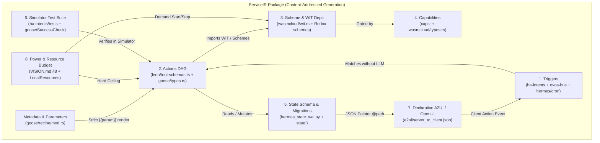
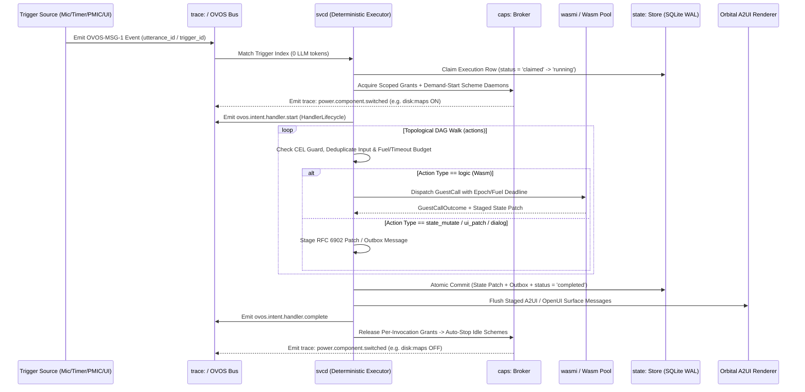

# Service IR & Deterministic Executor (`svc:` / `trace:` / `state:` / `caps:`)

**Task ID:** D1 (Wave 1)  
**Target OS:** Redox OS on OnePlus 6 (SDM845) — Language-Native Operating Layer (Part B4)  
**License:** MIT (clean-room specification; all donor concepts and schemas cited below carry MIT, Apache-2.0, BSD, or CC-BY-4.0 attribution)

---

## 1. Executive Summary & Architectural Role

In the language-native Redox phone OS (`docs/VISION.md` §§1–8, `docs/PLAN.md` Part B4), the Large Language Model (LLM) is the **compiler and architect**, not the per-tick runtime interpreter. When the user speaks or types a request—whether a one-off command ("set a timer for 10 minutes"), a standing rule ("tell me when battery drops below 20%"), or a composite application ("navigate to Portland offline")—the agent either matches an existing **Service Intermediate Representation (`ServiceIR`)** block via zero-LLM template/bus matching or compiles a new `ServiceIR` package on the fly.

Once compiled, validated, and granted capabilities by the `caps:` broker, the **Deterministic Executor** runs the `ServiceIR` DAG without waking the LLM on every trigger, sensor sample, or timer tick. Every trigger evaluation, state transition, capability check, UI surface patch, and power-state change is emitted as a structured event onto the `trace:` scheme (`docs/VISION.md` §3 "Open kimono"). Every hardware/daemon dependency is demand-started when a grant opens and stopped the instant the grant expires (`docs/VISION.md` §4 "Intelligent power" & §8 "Minimal by design").

### 1.1 Borrowed Ideas & Upstream Citations

Every structural element in `ServiceIR` and its executor is grounded in proven open-source prior art from `$HOME/Developer/forks/op6-refs/`:

| Subsystem | Borrowed Concept | Citation (`repo/path`) | Upstream License |
|---|---|---|---|
| **Package & Recipe Envelope** | Versioned recipe manifest, typed `parameters` (`required` / `optional` / `user_prompt`), `sub_recipes` with `sequential_when_repeated`, `response.json_schema` output contract, `RetryConfig` + `SuccessCheck` | `goose/crates/goose/src/recipe/mod.rs`, `goose/crates/goose/src/recipe/manifest.rs`, `goose/crates/goose/src/agents/types.rs` | Apache-2.0 |
| **Strict Template & Env Guards** | Strict `{{ var }}` rendering (`UndefinedBehavior::Strict`, no file loader) and 31-key environment variable denylist (`PATH`, `LD_PRELOAD`, etc.) | `goose/crates/goose/src/recipe/template_recipe.rs`, `goose/crates/goose/src/recipe/validate_recipe.rs`, `goose/crates/goose/src/agents/extension.rs` | Apache-2.0 |
| **Bus Envelope & Causal Derivations** | `OVOS-MSG-1` `{type, data, context}` JSON envelope; normative `forward` / `reply` / `response` derivations preserving `session` and `utterance_id` | `ovos-bus-client/ovos_bus_client/message.py`, `ovos-bus-client/ovos_bus_client/session.py` | Apache-2.0 |
| **Handler Lifecycle & Working Session** | `ovos.intent.handler.{start,complete,error}` trio with hard timeout backstop; quintuple intent manifest `(session_id, skill_id, intent_name, lang, method)`; transient `working_session` keyed by `utterance_id` (`_MAX_OPEN_ROUNDS = 32`); `PreDrainSnapshot` for targeted vs. global `ovos.stop` | `ovos-core/ovos_core/intent_services/dispatcher.py`, `ovos-core/ovos_core/intent_services/manifest.py`, `ovos-core/ovos_core/intent_services/working_session.py`, `ovos-core/ovos_core/intent_services/stop_service.py`, `ovos-core/ovos_core/intent_services/service.py`, `ovos-bus-client/ovos_bus_client/handler.py` | Apache-2.0 |
| **Zero-LLM Fast-Path Intents** | Domain/intent/slot schemas (`HassStartTimer`, etc.), `slot_combinations`, `response_variables`, and `speech_to_phrase` sentence templates | `ha-intents/intents.yaml`, `ha-intents/sentences/en/HassStartTimer/minutes_only.yaml`, `ha-intents/sentences/en/HassStartTimer/command_hours_minutes_seconds.yaml`, `ha-intents/tests/en/HassStartTimer/minutes_only.yaml` | CC-BY-4.0 (attribution required) |
| **Layered Action Graph & Tool Guards** | `Skills -> Actions -> Tools -> Functions` hierarchy; `workflow` array chaining actions across skills; `logic` vs. `dialog` action types; `read_only`, `deduplicate_calls`, `timeout: {idleMs, totalMs}`, `concurrency: parallel \| serial`, `hooks.post_execution.response_jq` | `leon/core/context/ARCHITECTURE.md`, `leon/server/src/schemas/skill-schemas.ts`, `leon/server/src/schemas/tool-schemas.ts`, `leon/server/src/core/tool-manager/tool-executor.ts`, `leon/skills/native/video_translator_skill/skill.json` | MIT |
| **Declarative UI & Streaming Patch DSL** | Surface lifecycle (`createSurface`, `updateComponents`, `updateDataModel`, `deleteSurface`), `@path` JSON-Pointer bindings, `@call` catalog functions (`formatString`), client `action` events, and OpenUI Lang `$var = ...` statement patching | `a2ui/specification/v0_9/json/server_to_client.json`, `a2ui/specification/v0_9/json/client_to_server.json`, `a2ui/specification/v0_9/json/client_capabilities.json`, `a2ui/catalogs/basic/v1/catalog.json`, `a2ui/catalogs/basic/v1/examples/28_countdown-timer.json`, `openui/packages/a2ui/src/protocol-schema.ts`, `openui/packages/a2ui/src/statement-patch.ts`, `openui/packages/a2ui/src/runtime-schema.ts` | Apache-2.0 (`a2ui`), MIT (`openui`) |
| **Transactions, Leases, Cron & Guards** | Author vs. scheduler field separation (`merge_job_definition`); advance-before-dispatch at-most-once recurring rule; execution state machine (`claimed -> running -> completed \| failed \| unknown`) with `scheduled_instant` unique index; SQLite WAL with 64 MiB cap; transcript/session mutation guards (`require_not_executing`, `require_target_advanceable`, `require_idle`); lifecycle self-kill guard | `hermes-agent/cron/job_definition.py`, `hermes-agent/cron/scheduler_tick.py`, `hermes-agent/cron/executions.py`, `hermes-agent/cron/execution_identity.py`, `hermes-agent/cron/lifecycle_guard.py`, `hermes-agent/hermes_state_wal.py`, `hermes-agent/hermes_state_mutation_guards.py` | MIT |
| **Wasm Sandbox, Pooling & Resource Caps** | `WitWorld` (`imports`/`exports` matching); `Component` (ephemeral or warm-pooled via `pool_size`, `max_invocations`, `max_concurrency`, `reclaim_window_seconds`) vs. `Service` (singleton stateful instance); `LocalResources` (`memory_limit_mb`, `cpu_limit`, `volume_mounts`, default-empty `allowed_hosts` / `allowed_ip_name_lookups` / `allowed_host_loopback_ports`); `INGRESS_BACKLOG = 256` and `GuestCall::deadline` | `wasmcloud/crates/wash-runtime/src/types.rs`, `wasmcloud/crates/wash-runtime/src/wit.rs`, `wasmcloud/crates/wash-runtime/src/engine/instance_pool.rs`, `wasmcloud/crates/wash-runtime/src/engine/dispatch.rs`, `wasmcloud/crates/wash-runtime/src/engine/workload.rs` | Apache-2.0 |

---

## 2. Typed Service IR (`ServiceIR`) Specification & JSON Schema

A **Service Package** on Redox is a self-contained, content-addressed JSON/YAML document conforming to the `ServiceIR` schema (`https://redox-op6.local/schemas/service-ir/v1.json`). It combines the eight required dimensions into one verifiable unit:

1. **Triggers (`triggers`)** — Zero-LLM event matchers: voice sentence templates (`ha-intents`), bus topics (`ovos-bus-client`), monotonic/wall timers (`hermes-agent/cron`), state/sensor threshold crossings with hysteresis, and UI surface actions (`a2ui`).
2. **Actions (`actions`)** — A deterministic DAG of typed steps (`logic`, `dialog`, `ui_patch`, `bus_emit`, `state_mutate`, `sub_service`) with `leon`-style execution guards (`read_only`, `deduplicate_calls`, `timeout`, `concurrency`, `effect_class`).
3. **Dependencies (`deps`)** — Required Redox schemes (`audio:`, `time:`, `sys:power`, `disk:maps`), Wasm components (`wit_world` imports/exports), and sub-services (`goose` `SubRecipe`), annotated with lifecycle binding (`on_demand`, `while_active`, `preload_none`).
4. **Capabilities (`capabilities`)** — Scoped, expiring, revocable permission requests (`caps:` scheme) mapped 1:1 to `wasmcloud` `LocalResources` and Fuchsia-style `use`/`offer`/`expose` declarations.
5. **State Schema (`state_schema`)** — JSON Schema Draft 2020-12 defining durable (`state:` scheme) and ephemeral working-session state, initial defaults, retention TTL, and pure JSON-Patch migrations between generations.
6. **Tests (`tests`)** — Deterministic simulator fixtures (`goose` `SuccessCheck` + `ha-intents` test YAML) specifying fake clock/battery/location/bus inputs and asserted state/bus/UI/power outcomes.
7. **UI (`ui`)** — Declarative `a2ui` v0.9/v1.0 component surfaces and `openui` statement patches bound to `/state/...` JSON Pointers, requiring zero imperative GUI code.
8. **Power & Resource Budget (`power_budget`)** — Strict hardware ceilings (Kryo 385 Silver vs. Gold core affinity, RAM MiB, Wasm fuel, wakeups/min, wake-lock max duration, network egress bytes = 0 by default) enforced by the supervisor (`VISION.md` §8).



### 2.1 Complete `ServiceIR` JSON Schema (Draft 2020-12)

```json
{
  "$schema": "https://json-schema.org/draft/2020-12/schema",
  "$id": "https://redox-op6.local/schemas/service-ir/v1.json",
  "title": "Redox Language-Native OS Service IR (v1.0.0)",
  "description": "Typed Intermediate Representation for deterministic, zero-LLM routines, services, and mini-apps on Redox OS (OnePlus 6 SDM845).",
  "type": "object",
  "required": [
    "ir_version",
    "id",
    "version",
    "title",
    "description",
    "execution_mode",
    "triggers",
    "actions",
    "deps",
    "capabilities",
    "state_schema",
    "ui",
    "power_budget",
    "tests"
  ],
  "additionalProperties": false,
  "properties": {
    "ir_version": {
      "const": "1.0.0",
      "description": "Schema version of the Service IR format (borrowed from goose/crates/goose/src/recipe/mod.rs)."
    },
    "id": {
      "type": "string",
      "pattern": "^svc\\.[a-z0-9_]+(\\.[a-z0-9_]+)+$",
      "description": "Reverse-domain style canonical service identifier (e.g. 'svc.nav.offline_route')."
    },
    "version": {
      "type": "string",
      "pattern": "^(0|[1-9]\\d*)\\.(0|[1-9]\\d*)\\.(0|[1-9]\\d*)$",
      "description": "Semantic version of this service block."
    },
    "generation": {
      "type": "integer",
      "minimum": 1,
      "default": 1,
      "description": "Monotonic Nix-style generation number for atomic hot-reload and rollback (PLAN.md B8)."
    },
    "content_hash": {
      "type": "string",
      "pattern": "^blake3:[0-9a-f]{64}$",
      "description": "BLAKE3 digest of the canonicalized IR + Wasm component bytes."
    },
    "title": {
      "type": "string",
      "minLength": 3,
      "maxLength": 80,
      "description": "Short human-readable title (goose/crates/goose/src/recipe/mod.rs)."
    },
    "description": {
      "type": "string",
      "minLength": 8,
      "maxLength": 512,
      "description": "Detailed description exposed to the user and trace inspector."
    },
    "author": {
      "type": "object",
      "additionalProperties": false,
      "properties": {
        "name": { "type": "string" },
        "contact": { "type": "string" },
        "provenance": {
          "type": "string",
          "enum": ["user_voice", "user_text", "system_builtin", "community_registry", "llm_synthesized"]
        }
      },
      "required": ["name", "provenance"]
    },
    "execution_mode": {
      "type": "string",
      "enum": ["ephemeral_component", "warm_pooled_component", "singleton_service"],
      "description": "Instantiation lifecycle borrowed from wasmcloud/crates/wash-runtime/src/types.rs and engine/instance_pool.rs."
    },
    "priority_class": {
      "type": "string",
      "enum": [
        "P0_SAFETY_THERMAL",
        "P1_USER_ABORT_STOP",
        "P2_INTERACTIVE_VOICE_UI",
        "P3_ACTIVE_FOREGROUND_NAV",
        "P4_BACKGROUND_MONITOR"
      ],
      "default": "P2_INTERACTIVE_VOICE_UI",
      "description": "Deterministic priority tier used by the Conflict Resolver."
    },
    "parameters": {
      "type": "array",
      "maxItems": 32,
      "description": "Typed template parameters rendered via strict MiniJinja before execution (goose/crates/goose/src/recipe/mod.rs & validate_recipe.rs).",
      "items": { "$ref": "#/$defs/Parameter" }
    },
    "triggers": {
      "type": "array",
      "minItems": 1,
      "description": "Events that wake and fire this service without invoking an LLM.",
      "items": { "$ref": "#/$defs/Trigger" }
    },
    "workflow": {
      "type": "array",
      "minItems": 1,
      "items": { "type": "string" },
      "description": "Topologically ordered entrypoint action IDs or cross-service references (leon/skills/native/video_translator_skill/skill.json)."
    },
    "actions": {
      "type": "object",
      "minProperties": 1,
      "description": "Named action nodes forming a deterministic DAG (leon/server/src/schemas/skill-schemas.ts & tool-schemas.ts).",
      "additionalProperties": { "$ref": "#/$defs/ActionNode" }
    },
    "deps": {
      "$ref": "#/$defs/Dependencies"
    },
    "capabilities": {
      "type": "array",
      "description": "Scoped capability grants required from the caps: broker.",
      "items": { "$ref": "#/$defs/CapabilityGrantRequest" }
    },
    "state_schema": {
      "$ref": "#/$defs/StateSpecification"
    },
    "ui": {
      "$ref": "#/$defs/UiSpecification"
    },
    "power_budget": {
      "$ref": "#/$defs/PowerResourceBudget"
    },
    "retry": {
      "$ref": "#/$defs/RetryConfig"
    },
    "tests": {
      "type": "array",
      "minItems": 1,
      "description": "Mandatory simulator test cases run before installation or generation switch.",
      "items": { "$ref": "#/$defs/SimulatorTestCase" }
    }
  },
  "$defs": {
    "Parameter": {
      "type": "object",
      "required": ["key", "input_type", "requirement", "description"],
      "additionalProperties": false,
      "properties": {
        "key": { "type": "string", "pattern": "^[a-z][a-z0-9_]*$" },
        "input_type": {
          "type": "string",
          "enum": ["string", "number", "boolean", "date", "duration_sec", "select"]
        },
        "requirement": {
          "type": "string",
          "enum": ["required", "optional", "user_prompt"]
        },
        "description": { "type": "string" },
        "default": { "type": ["string", "number", "boolean", "null"] },
        "options": {
          "type": "array",
          "maxItems": 200,
          "items": { "type": "string" }
        }
      }
    },
    "Trigger": {
      "type": "object",
      "required": ["id", "kind", "entry_action"],
      "additionalProperties": false,
      "properties": {
        "id": { "type": "string", "pattern": "^trig_[a-z0-9_]+$" },
        "kind": {
          "type": "string",
          "enum": [
            "voice_intent",
            "bus_message",
            "timer_schedule",
            "sensor_threshold",
            "ui_action",
            "lifecycle_stop"
          ]
        },
        "entry_action": {
          "type": "string",
          "description": "Action ID in `actions` to invoke when this trigger fires."
        },
        "condition_cel": {
          "type": "string",
          "description": "Optional deterministic guard expression over trigger payload and current state."
        },
        "debounce_ms": {
          "type": "integer",
          "minimum": 0,
          "default": 0
        },
        "cooldown_ms": {
          "type": "integer",
          "minimum": 0,
          "default": 0,
          "description": "Minimum time between consecutive firings of this trigger."
        },
        "voice_intent": {
          "type": "object",
          "description": "Zero-LLM template matcher (ha-intents/intents.yaml + ovos-core/intent_services/manifest.py).",
          "required": ["domain", "intent_name", "lang", "sentences"],
          "additionalProperties": false,
          "properties": {
            "domain": { "type": "string" },
            "intent_name": {
              "type": "string",
              "not": { "enum": ["converse", "response", "stop", "fallback", "common_query"] }
            },
            "lang": { "type": "string", "default": "en-US" },
            "method": { "type": "string", "enum": ["template", "keyword", "regex"], "default": "template" },
            "speech_to_phrase": { "type": "boolean", "default": true },
            "sentences": { "type": "array", "minItems": 1, "items": { "type": "string" } },
            "slots": {
              "type": "object",
              "additionalProperties": {
                "type": "object",
                "required": ["type", "required"],
                "properties": {
                  "type": { "type": "string", "enum": ["string", "integer", "float", "duration", "enum"] },
                  "required": { "type": "boolean" },
                  "default": {}
                }
              }
            }
          }
        },
        "bus_message": {
          "type": "object",
          "description": "OVOS-MSG-1 topic matcher (ovos-bus-client/ovos_bus_client/message.py).",
          "required": ["msg_type"],
          "additionalProperties": false,
          "properties": {
            "msg_type": { "type": "string" },
            "data_filter": { "type": "object" },
            "require_session": { "type": "boolean", "default": true }
          }
        },
        "timer_schedule": {
          "type": "object",
          "description": "Monotonic or wall-clock timer (hermes-agent/cron/job_definition.py & scheduler_tick.py).",
          "required": ["mode"],
          "additionalProperties": false,
          "properties": {
            "mode": { "type": "string", "enum": ["countdown_monotonic", "interval_monotonic", "cron_wall", "oneshot_iso"] },
            "duration_sec_expr": { "type": "string", "description": "Literal seconds or state/slot pointer e.g. '$.state.remaining_sec'." },
            "cron_expr": { "type": "string" },
            "catchup_policy": { "type": "string", "enum": ["advance_before_dispatch", "drop_missed", "fire_once_within_grace"], "default": "advance_before_dispatch" },
            "grace_window_sec": { "type": "integer", "minimum": 0, "maximum": 7200, "default": 120 },
            "wake_from_suspend": { "type": "boolean", "default": false }
          }
        },
        "sensor_threshold": {
          "type": "object",
          "description": "Hardware scheme edge-triggered threshold with hysteresis so values hovering near the threshold do not bounce.",
          "required": ["scheme_path", "metric", "operator", "threshold", "hysteresis_reset"],
          "additionalProperties": false,
          "properties": {
            "scheme_path": { "type": "string", "pattern": "^(sys|sensor|power|audio|net):[a-z0-9_/.-]+$" },
            "metric": { "type": "string" },
            "operator": { "type": "string", "enum": ["lt", "lte", "gt", "gte", "eq"] },
            "threshold": { "type": "number" },
            "hysteresis_reset": {
              "type": "number",
              "description": "Value the metric must cross in the opposite direction to re-arm the trigger."
            },
            "edge_only": { "type": "boolean", "default": true },
            "poll_or_irq": { "type": "string", "enum": ["irq_event", "spmi_comparator", "poll_slow"], "default": "irq_event" }
          }
        },
        "ui_action": {
          "type": "object",
          "description": "A2UI client-to-server action event matcher (a2ui/specification/v0_9/json/client_to_server.json).",
          "required": ["surface_id", "action_name"],
          "additionalProperties": false,
          "properties": {
            "surface_id": { "type": "string" },
            "action_name": { "type": "string" },
            "source_component_id": { "type": "string" }
          }
        }
      }
    },
    "ActionNode": {
      "type": "object",
      "required": ["type", "description", "effect_class", "read_only", "timeout"],
      "additionalProperties": false,
      "properties": {
        "type": {
          "type": "string",
          "enum": ["logic", "dialog", "ui_patch", "bus_emit", "state_mutate", "sub_service"],
          "description": "Action execution type (leon/server/src/schemas/skill-schemas.ts + Redox extensions)."
        },
        "description": { "type": "string", "minLength": 8, "maxLength": 256 },
        "effect_class": {
          "type": "string",
          "enum": ["pure", "reversible_staged", "reversible_compensated", "committed_irreversible"],
          "description": "Transaction model classification (Section 4)."
        },
        "idempotency_key_template": {
          "type": "string",
          "description": "Template producing deterministic key e.g. '{{service_id}}:{{execution_id}}:{{action_id}}'."
        },
        "read_only": {
          "type": "boolean",
          "description": "Whether this action leaves durable/external state unchanged (leon/server/src/schemas/tool-schemas.ts)."
        },
        "deduplicate_calls": {
          "type": "boolean",
          "default": true,
          "description": "Block repeated identical inputs within the same state generation (leon/server/src/schemas/tool-schemas.ts)."
        },
        "concurrency": {
          "type": "string",
          "enum": ["serial", "parallel"],
          "default": "serial",
          "description": "Serial preserves instance state; parallel runs in isolated Wasm store (leon/server/src/schemas/tool-schemas.ts)."
        },
        "timeout": {
          "type": "object",
          "required": ["idle_ms", "total_ms"],
          "additionalProperties": false,
          "properties": {
            "idle_ms": { "type": "integer", "minimum": 10, "maximum": 300000 },
            "total_ms": { "type": "integer", "minimum": 10, "maximum": 300000 }
          }
        },
        "wasm_call": {
          "type": "object",
          "description": "For type='logic': WIT interface function invocation on the sandboxed Wasm component.",
          "required": ["component_ref", "wit_interface", "function", "args_mapping"],
          "additionalProperties": false,
          "properties": {
            "component_ref": { "type": "string" },
            "wit_interface": { "type": "string", "pattern": "^[a-z0-9-]+:[a-z0-9-]+/[a-z0-9-]+(@[0-9.]+)?$" },
            "function": { "type": "string" },
            "args_mapping": { "type": "object" },
            "output_state_pointer": { "type": "string", "pattern": "^/[a-zA-Z0-9_/-]*$" },
            "post_hook_jq": { "type": "string" }
          }
        },
        "state_patch": {
          "type": "array",
          "description": "For type='state_mutate': RFC 6902 JSON Patch operations staged into the working transaction.",
          "items": {
            "type": "object",
            "required": ["op", "path"],
            "properties": {
              "op": { "type": "string", "enum": ["add", "replace", "remove", "test"] },
              "path": { "type": "string", "pattern": "^/[a-zA-Z0-9_/-]+$" },
              "value": {}
            }
          }
        },
        "dialog": {
          "type": "object",
          "description": "For type='dialog': Spoken (Wyoming TTS) and written answer without Wasm code (leon/server/src/schemas/skill-schemas.ts).",
          "required": ["speech", "text"],
          "additionalProperties": false,
          "properties": {
            "speech": { "type": "string" },
            "text": { "type": "string" },
            "priority": { "type": "string", "enum": ["normal", "alert", "critical"], "default": "normal" }
          }
        },
        "ui_patch": {
          "type": "object",
          "description": "For type='ui_patch': A2UI surface message or OpenUI statement patch.",
          "required": ["surface_id", "operation"],
          "additionalProperties": false,
          "properties": {
            "surface_id": { "type": "string" },
            "operation": { "type": "string", "enum": ["create_surface", "update_components", "update_data_model", "delete_surface", "openui_statements"] },
            "data_model_path": { "type": "string" },
            "data_model_value": {},
            "openui_statements": { "type": "array", "items": { "type": "string" } }
          }
        },
        "bus_emit": {
          "type": "object",
          "description": "For type='bus_emit': Emit an OVOS-MSG-1 message onto the bus/trace scheme.",
          "required": ["derivation", "msg_type", "data"],
          "additionalProperties": false,
          "properties": {
            "derivation": { "type": "string", "enum": ["forward", "reply", "response", "root"] },
            "msg_type": { "type": "string" },
            "data": { "type": "object" }
          }
        },
        "compensating_action": {
          "type": "string",
          "description": "Action ID to execute on rollback if `effect_class` is `reversible_compensated`."
        },
        "next": {
          "type": "array",
          "description": "Conditional edges to successor Action IDs in the DAG.",
          "items": {
            "type": "object",
            "required": ["target"],
            "additionalProperties": false,
            "properties": {
              "when_cel": { "type": "string" },
              "target": { "type": "string" }
            }
          }
        }
      }
    },
    "Dependencies": {
      "type": "object",
      "required": ["schemes", "wasm_components", "sub_services"],
      "additionalProperties": false,
      "properties": {
        "schemes": {
          "type": "array",
          "description": "Redox kernel/userspace schemes required by this service.",
          "items": {
            "type": "object",
            "required": ["scheme", "access", "lifecycle"],
            "additionalProperties": false,
            "properties": {
              "scheme": { "type": "string", "pattern": "^[a-z0-9_.-]+:([a-zA-Z0-9_./-]*)?$" },
              "access": { "type": "string", "enum": ["read", "write", "read_write", "event_subscribe"] },
              "lifecycle": {
                "type": "string",
                "enum": ["demand_per_action", "while_surface_visible", "while_grant_alive", "always_resident_kernel"],
                "description": "Determines when the scheme daemon is started and stopped (VISION.md §4 & §8)."
              }
            }
          }
        },
        "wasm_components": {
          "type": "array",
          "description": "Sandboxed Wasm components and their WIT worlds (wasmcloud/crates/wash-runtime/src/wit.rs & types.rs).",
          "items": {
            "type": "object",
            "required": ["id", "digest", "wit_world", "pool_policy"],
            "additionalProperties": false,
            "properties": {
              "id": { "type": "string" },
              "digest": { "type": "string", "pattern": "^sha256:[0-9a-f]{64}$" },
              "wit_world": {
                "type": "object",
                "required": ["imports", "exports"],
                "properties": {
                  "imports": { "type": "array", "items": { "type": "string" } },
                  "exports": { "type": "array", "items": { "type": "string" } }
                }
              },
              "pool_policy": {
                "type": "object",
                "required": ["pool_size", "max_invocations", "max_concurrency", "reclaim_window_seconds"],
                "properties": {
                  "pool_size": { "type": "integer", "minimum": 0, "maximum": 4 },
                  "max_invocations": { "type": "integer", "minimum": 1, "maximum": 10000 },
                  "max_concurrency": { "type": "integer", "minimum": 1, "maximum": 4 },
                  "reclaim_window_seconds": { "type": "integer", "minimum": 0, "maximum": 3600 }
                }
              }
            }
          }
        },
        "sub_services": {
          "type": "array",
          "description": "Composable sub-recipes/services (goose/crates/goose/src/recipe/mod.rs SubRecipe).",
          "items": {
            "type": "object",
            "required": ["name", "service_id", "sequential_when_repeated"],
            "additionalProperties": false,
            "properties": {
              "name": { "type": "string" },
              "service_id": { "type": "string" },
              "min_version": { "type": "string" },
              "values": { "type": "object", "additionalProperties": { "type": "string" } },
              "sequential_when_repeated": { "type": "boolean", "default": true }
            }
          }
        }
      }
    },
    "CapabilityGrantRequest": {
      "type": "object",
      "required": ["cap_id", "capability", "scope", "lifetime", "max_duration_sec", "audit_reason"],
      "additionalProperties": false,
      "properties": {
        "cap_id": { "type": "string" },
        "capability": {
          "type": "string",
          "enum": [
            "audio.capture",
            "audio.playback.tts",
            "audio.playback.alarm",
            "location.gnss.read",
            "storage.maps.readonly",
            "state.namespace.readwrite",
            "power.battery.read",
            "power.request_wake",
            "timer.monotonic.schedule",
            "ui.surface.render",
            "network.connect"
          ]
        },
        "scope": {
          "type": "object",
          "description": "Fine-grained constraints (e.g. path prefix, allowed_hosts, max wake lock seconds)."
        },
        "lifetime": {
          "type": "string",
          "enum": ["per_invocation", "while_visible", "until_deadline", "standing_trigger_watch"]
        },
        "max_duration_sec": { "type": "integer", "minimum": 1, "maximum": 86400 },
        "revocable": { "type": "boolean", "default": true },
        "audit_reason": {
          "type": "string",
          "description": "Human-readable explanation announced on trace: when the capability is exercised (VISION.md §3 & §4)."
        }
      }
    },
    "StateSpecification": {
      "type": "object",
      "required": ["namespace", "durability", "schema", "initial_state"],
      "additionalProperties": false,
      "properties": {
        "namespace": { "type": "string", "pattern": "^state:[a-z0-9_.-]+$" },
        "durability": { "type": "string", "enum": ["ephemeral_session", "sqlite_wal_durable"] },
        "wal_limit_bytes": { "type": "integer", "default": 4194304, "maximum": 67108864 },
        "retention_ttl_sec": { "type": "integer", "minimum": 0 },
        "schema": { "type": "object", "description": "JSON Schema for the service's state object." },
        "initial_state": { "type": "object" },
        "migrations": {
          "type": "array",
          "items": {
            "type": "object",
            "required": ["from_version", "to_version", "json_patch"],
            "properties": {
              "from_version": { "type": "string" },
              "to_version": { "type": "string" },
              "json_patch": { "type": "array" }
            }
          }
        }
      }
    },
    "UiSpecification": {
      "type": "object",
      "required": ["mode"],
      "additionalProperties": false,
      "properties": {
        "mode": { "type": "string", "enum": ["none", "a2ui_v1", "openui_stream"] },
        "surface_id": { "type": "string" },
        "catalog_id": {
          "type": "string",
          "default": "https://a2ui.org/specification/v1_0/catalogs/basic/catalog.json"
        },
        "send_data_model": { "type": "boolean", "default": true },
        "initial_messages": {
          "type": "array",
          "description": "Declarative A2UI createSurface / updateComponents / updateDataModel messages (a2ui/specification/v0_9/json/server_to_client.json).",
          "items": { "type": "object" }
        },
        "openui_statements": {
          "type": "array",
          "description": "Optional OpenUI Lang statement blocks (openui/packages/a2ui/src/statement-patch.ts).",
          "items": { "type": "string" }
        }
      }
    },
    "PowerResourceBudget": {
      "type": "object",
      "description": "Hard resource & power limits enforced by the supervisor (VISION.md §8 + wasmcloud LocalResources).",
      "required": [
        "cpu_cluster_preference",
        "max_cpu_cores",
        "cpu_quota_pct",
        "memory_limit_mb",
        "wasm_fuel_per_invocation",
        "max_wakeups_per_minute",
        "max_wakelock_sec",
        "network_egress_bytes_max",
        "allowed_hosts",
        "allowed_ip_name_lookups",
        "allowed_host_loopback_ports",
        "auto_stop_idle_ms",
        "power_announcement"
      ],
      "additionalProperties": false,
      "properties": {
        "cpu_cluster_preference": {
          "type": "string",
          "enum": ["silver_only", "silver_preferred", "gold_burst_allowed"],
          "description": "SDM845 Kryo 385 Silver (cores 0-3, 1.76 GHz efficiency) vs Gold (cores 4-7, 2.8 GHz performance)."
        },
        "max_cpu_cores": { "type": "integer", "minimum": 1, "maximum": 4, "default": 1 },
        "cpu_quota_pct": { "type": "integer", "minimum": 1, "maximum": 100, "default": 10 },
        "memory_limit_mb": { "type": "integer", "minimum": 1, "maximum": 256 },
        "wasm_fuel_per_invocation": { "type": "integer", "minimum": 1000, "maximum": 500000000 },
        "max_wakeups_per_minute": { "type": "number", "minimum": 0, "maximum": 600 },
        "max_wakelock_sec": { "type": "integer", "minimum": 0, "maximum": 3600 },
        "network_egress_bytes_max": {
          "type": "integer",
          "minimum": 0,
          "default": 0,
          "description": "0 enforces strictly offline execution (VISION.md §8)."
        },
        "allowed_hosts": {
          "type": "array",
          "items": { "type": "string" },
          "default": [],
          "description": "Empty array = deny all outbound connections (wasmcloud/crates/wash-runtime/src/types.rs)."
        },
        "allowed_ip_name_lookups": {
          "type": "array",
          "items": { "type": "string" },
          "default": [],
          "description": "Empty array = deny all DNS resolution (wasmcloud/crates/wash-runtime/src/types.rs)."
        },
        "allowed_host_loopback_ports": {
          "type": "array",
          "items": { "type": "integer" },
          "default": [],
          "description": "Empty array = deny all loopback ports (wasmcloud/crates/wash-runtime/src/types.rs)."
        },
        "auto_stop_idle_ms": {
          "type": "integer",
          "minimum": 0,
          "description": "Supervisor stops the component/service and unmounts scheme daemons after this idle window."
        },
        "power_announcement": {
          "type": "string",
          "description": "Exact template announced on trace:/UI when hardware components switch on or off (VISION.md §4)."
        }
      }
    },
    "RetryConfig": {
      "type": "object",
      "description": "Bounded retry configuration (goose/crates/goose/src/agents/types.rs).",
      "required": ["max_retries", "timeout_seconds", "checks"],
      "additionalProperties": false,
      "properties": {
        "max_retries": { "type": "integer", "minimum": 1, "maximum": 5 },
        "timeout_seconds": { "type": "integer", "minimum": 1, "maximum": 300 },
        "on_failure_action": { "type": "string" },
        "on_failure_timeout_seconds": { "type": "integer", "minimum": 1, "maximum": 600 },
        "checks": {
          "type": "array",
          "items": {
            "type": "object",
            "required": ["type", "expr"],
            "properties": {
              "type": { "type": "string", "enum": ["state_assertion", "scheme_health"] },
              "expr": { "type": "string" }
            }
          }
        }
      }
    },
    "SimulatorTestCase": {
      "type": "object",
      "required": ["name", "initial_env", "events", "assertions"],
      "additionalProperties": false,
      "properties": {
        "name": { "type": "string" },
        "description": { "type": "string" },
        "initial_env": {
          "type": "object",
          "required": ["monotonic_ms", "wall_iso", "battery_pct", "charging", "network_online", "location"],
          "properties": {
            "monotonic_ms": { "type": "integer", "minimum": 0 },
            "wall_iso": { "type": "string", "format": "date-time" },
            "battery_pct": { "type": "number", "minimum": 0, "maximum": 100 },
            "charging": { "type": "boolean" },
            "network_online": { "type": "boolean" },
            "location": {
              "type": "object",
              "required": ["lat", "lon", "tz"],
              "properties": {
                "lat": { "type": "number" },
                "lon": { "type": "number" },
                "tz": { "type": "string" }
              }
            }
          }
        },
        "events": {
          "type": "array",
          "minItems": 1,
          "items": {
            "type": "object",
            "required": ["at_monotonic_ms", "event_type", "payload"],
            "properties": {
              "at_monotonic_ms": { "type": "integer", "minimum": 0 },
              "event_type": {
                "type": "string",
                "enum": ["utterance", "bus_message", "advance_clock", "sensor_sample", "ui_action", "stop_signal"]
              },
              "payload": { "type": "object" }
            }
          }
        },
        "assertions": {
          "type": "object",
          "required": ["final_state_subset", "expected_bus_emissions", "expected_ui_surfaces", "budget_assertions"],
          "properties": {
            "final_state_subset": { "type": "object" },
            "expected_bus_emissions": { "type": "array", "items": { "type": "object" } },
            "expected_ui_surfaces": { "type": "array", "items": { "type": "object" } },
            "budget_assertions": {
              "type": "object",
              "required": ["max_memory_mb_used", "network_bytes_sent", "active_schemes_after_completion"],
              "properties": {
                "max_memory_mb_used": { "type": "number" },
                "network_bytes_sent": { "type": "integer" },
                "active_schemes_after_completion": { "type": "array", "items": { "type": "string" } }
              }
            }
          }
        }
      }
    }
  }
}
```

---

## 3. The Deterministic Executor (`svc:` Daemon)

The Deterministic Executor (`svcd`) is a single-binary Rust userspace daemon on Redox that exposes the `svc:` control scheme (`svc:list`, `svc:describe/<id>`, `svc:start/<id>`, `svc:stop/<id>`, `svc:simulate/<id>`) and drives all installed `ServiceIR` graphs without invoking an LLM.

### 3.1 Zero-LLM Fast Path vs. Agent Compilation Path

1. **Ingress Normalization (`ovos-bus-client/ovos_bus_client/message.py` & `session.py`)**:
   - Every voice utterance (`recognizer_loop:utterance`), hardware interrupt/threshold (`sys:power/battery`), monotonic timer expiry (`time:monotonic`), or UI tap (`a2ui.action`) enters `svcd` wrapped in an `OVOS-MSG-1` envelope `{ "type": "...", "data": {...}, "context": { "session": {...}, "utterance_id": "..." } }`.
   - `session.location` always uses the flat `{lat, lon, tz}` representation (`ovos-bus-client/ovos_bus_client/session.py` §3.5).
2. **Quintuple Trigger Index (`ovos-core/ovos_core/intent_services/manifest.py`)**:
   - `svcd` maintains an in-memory `IntentManifest` indexed by `(session_id, service_id, trigger_id, lang, method)` alongside an edge-triggered sensor comparator table and a monotonic timer heap.
   - Voice utterances are matched against `ha-intents` sentence templates (`speech_to_phrase: true` subset first) in `< 1 ms` on a single Silver core.
   - Only if **no** registered `ServiceIR` trigger matches does `svcd` emit `ovos.intent.fallback` to wake the Goose/Hermes agent harness (B3).
3. **Working Session & Deployment-Owned Fields (`ovos-core/ovos_core/intent_services/working_session.py` & `service.py`)**:
   - When a trigger fires, `svcd` opens a transient `WorkingSession` keyed by `utterance_id` (or `execution_id` for non-voice triggers), bounded by `_MAX_OPEN_ROUNDS = 32` to prevent memory leaks from orphaned rounds.
   - Deployment-owned fields (`pipeline`, `blacklisted_skills`, `site_id`, capability ceilings) are frozen before dispatch (`_DEPLOYMENT_OWNED_SESSION_FIELDS` in `ovos-core/ovos_core/intent_services/service.py`) so no service handler can relax security or routing policy for subsequent stages.

### 3.2 Step-by-Step Deterministic Execution Loop



1. **Strict Parameter & Template Binding (`goose/crates/goose/src/recipe/template_recipe.rs` & `extension.rs`)**:
   - Extracted slot values and parameters are validated against `parameters` (`MAX_PARAMETERS = 32`, `MAX_PARAMETERS_SIZE_BYTES = 128 KiB`).
   - Templates are rendered with `UndefinedBehavior::Strict` and a null loader (`set_loader(|_| Ok(None))`) so templates can never read arbitrary files.
   - Any environment map passed to a component is scrubbed against the 31-key `Envs::DISALLOWED_KEYS` list (`PATH`, `LD_PRELOAD`, `LD_LIBRARY_PATH`, `PYTHONPATH`, `NODE_OPTIONS`, etc. from `goose/crates/goose/src/agents/extension.rs`).
2. **Admission & Advance-Before-Dispatch (`hermes-agent/cron/scheduler_tick.py`)**:
   - For recurring timer triggers (`interval_monotonic`, `cron_wall`), `svcd` persists `next_run_at` **before** dispatching any action (`_advance_or_drop_recurring`). If the store is unwritable, recurring triggers are dropped rather than risking an infinite crash-refire loop (at-most-once guarantee).
3. **Capability Acquisition & Power Bring-Up (`wasmcloud/crates/wash-runtime/src/engine/workload.rs`)**:
   - `svcd` requests the service's declared `capabilities` from `caps:`.
   - `caps:` verifies that the service's `WitWorld` imports match the capability providers (`WitWorld::uses` in `wasmcloud/crates/wash-runtime/src/wit.rs`), starts any required Redox scheme daemon not currently running, and emits a `trace:` event with the service's `power_announcement`.
4. **DAG Traversal & Wasm Guest Dispatch (`wasmcloud/crates/wash-runtime/src/engine/dispatch.rs` & `instance_pool.rs`)**:
   - Each `ActionNode` in `workflow` order is evaluated:
     - **CEL Guard**: Evaluates `when_cel` deterministically (no floating-point NaN non-determinism, no syscalls, no wall-clock reads—time comes solely from the injected `ExecutionContext` instant).
     - **Deduplication Guard (`leon/server/src/schemas/tool-schemas.ts`)**: If `deduplicate_calls: true`, `svcd` hashes `(action_id, canonical_args_json, state_generation)`. If an identical call already succeeded in this state generation, the cached observation is reused.
     - **Wasm Invocation**: Dispatched as a `GuestCall` (`wasmcloud/crates/wash-runtime/src/engine/dispatch.rs`, `INGRESS_BACKLOG = 256`).
       - `ephemeral_component`: Fresh `wasmi` store built, invoked, and dropped immediately after the call (`pool_size = 0`).
       - `warm_pooled_component`: Reuses up to `pool_size` warm instances across calls until `max_invocations` or `reclaim_window_seconds` retires the instance (`wasmcloud/crates/wash-runtime/src/engine/instance_pool.rs`).
       - `singleton_service`: Routes into the single running service instance over its trigger ingress.
     - **Hard Epoch / Fuel & Idle Deadlines**: Re-armed per call (`GuestCall::deadline` + `timeout.idle_ms` / `timeout.total_ms` from `leon/server/src/schemas/tool-schemas.ts`). If a guest traps or times out, its store is poisoned and immediately reaped (`instance_pool.rs` lines 28–32).
     - **Post-Execution Projection (`leon/server/src/schemas/tool-schemas.ts`)**: Optional `post_hook_jq` extracts only the required fields from the Wasm return value before writing to `output_state_pointer`.
5. **Handler Lifecycle Trio (`ovos-core/ovos_core/intent_services/dispatcher.py` & `ovos-bus-client/ovos_bus_client/handler.py`)**:
   - Wrapped in `HandlerLifecycle`, emitting `ovos.intent.handler.start` before the first node and exactly one terminal (`ovos.intent.handler.complete` or `ovos.intent.handler.error`) upon exit or timeout.

---

## 4. Transaction Model: Reversible vs. Committed Effects & Idempotency

Because an action DAG may fail mid-flight (e.g., Wasm fuel exhaustion, capability revocation, or user barge-in `"stop"`), `svcd` executes every trigger invocation inside an explicit **Two-Phase Deterministic Transaction**.

### 4.1 Four Effect Classes (`effect_class`)

Every `ActionNode` MUST declare one of four effect classes:

| Effect Class | Semantics | Execution Phase | On Transaction Abort / Rollback |
|---|---|---|---|
| `pure` | Read-only computation (`read_only: true`), route calculation, template formatting. | Runs in-memory against a read snapshot of `state:`. | Discard in-memory scratchpad; zero side effects. |
| `reversible_staged` | State mutations (`state_mutate`), UI surface updates (`ui_patch`), and internal bus emissions (`bus_emit`). | Applied to an isolated in-memory **Copy-on-Write (CoW) State Overlay** and an **Outbox Queue**. | Drop CoW overlay and Outbox Queue; neither `state:` nor the UI renderer ever sees partial writes. |
| `reversible_compensated` | External hardware/scheme changes with a deterministic inverse (e.g., acquiring a wake lock, registering a kernel timer, dimming display brightness). | Executed during DAG walk after recording a **Compensation Log** entry `{action_id, compensating_action, pre_value}` in the WAL. | Executor runs each recorded `compensating_action` in reverse topological order (LIFO) using the captured `pre_value`. |
| `committed_irreversible` | Physical or external side effects that cannot be un-done once emitted (e.g., speaking audio over the speaker, playing an alarm chime, sending a network packet). | Deferred to the **Post-Commit Outbox Flush** whenever possible; if mid-DAG, requires a prior checkpoint commit. | Cannot be rolled back; recorded as `completed` in the idempotency ledger so a retry never duplicates the physical effect. |

### 4.2 Durable Execution Ledger & Idempotency Keys

Borrowed directly from `hermes-agent/cron/executions.py`, `hermes-agent/cron/execution_identity.py`, and `hermes-agent/hermes_state_wal.py`:

1. **SQLite WAL State Store (`hermes-agent/hermes_state_wal.py`)**:
   - The `state:` scheme daemon backs durable state and the execution ledger with SQLite in `PRAGMA journal_mode=WAL`, `PRAGMA synchronous=FULL`, and a hard WAL size cap (`_WAL_SIZE_LIMIT_BYTES` scaled to 4 MiB per service, 64 MiB system-wide ceiling).
   - If the underlying filesystem does not support mmap/locks (e.g., early RAM-root initfs before UFS bring-up), `state:` falls back cleanly to rollback-journal mode (`_WAL_INCOMPAT_MARKERS`).
2. **Execution State Machine (`hermes-agent/cron/executions.py`)**:
   - Every trigger firing creates a row in `executions` with status transitions:
     $$\texttt{claimed} \longrightarrow \texttt{running} \longrightarrow \texttt{completed} \mid \texttt{failed} \mid \texttt{unknown}$$
   - Terminal states (`completed`, `failed`, `unknown`) are **immutable**. An interrupted execution is marked `unknown` only after its owner process `(process_id, pid, process_started_at)` is proven dead.
3. **Deterministic Idempotency Keys**:
   - Each non-pure action computes:
     $$\text{idempotency\_key} = \text{BLAKE3}(\text{service\_id} \;\|\; \text{trigger\_id} \;\|\; \text{scheduled\_instant\_or\_utterance\_id} \;\|\; \text{action\_id} \;\|\; \text{canonical\_args})$$
   - Following `hermes-agent/cron/executions.py` (`idx_executions_occurrence ON executions(job_id, scheduled_instant) WHERE status='completed'`), the ledger enforces a `UNIQUE(service_id, idempotency_key)` constraint on committed effects.
   - If a service retries (`RetryConfig` from `goose/crates/goose/src/agents/types.rs`), any action whose `idempotency_key` is already recorded as `completed` is skipped and its stored output observation is replayed verbatim.
4. **Mutation Fencing (`hermes-agent/hermes_state_mutation_guards.py`)**:
   - Hot-reloading a service generation (B8), migrating its `state_schema`, or resetting its state calls `require_target_advanceable(service_id)`:
     - Refuses with `service_busy` (`409`) if any execution is in `running` or `unknown` state or holds a live transaction lease (`require_not_executing`).
     - Queued triggers wait on the logical service ID and run against the newly published generation once the atomic switch completes.

---

## 5. Deterministic Simulator (`svc:simulate`)

Before any LLM-synthesized or user-modified `ServiceIR` is admitted into the live `svcd` manifest (or promoted to a new Nix-style generation under `PLAN.md` B8), it MUST pass its embedded `tests` suite inside the **Deterministic Simulator**.

### 5.1 Virtualized Environment & Zero-Hardware Execution

The simulator instantiates the exact same `svcd` executor and `wasmi` sandbox used in production, but binds all Redox schemes to deterministic in-memory mocks:

- **Virtual Monotonic & Wall Clock (`time:`)**: Driven by a discrete-event priority queue. Advancing time from `t = 0` to `t = 600,000 ms` happens in microseconds of host CPU time—no real `sleep()` calls are ever made.
- **Virtual Battery / PMIC / Thermal (`sys:power/*`)**: Replays scripted voltage, state-of-charge (`battery_pct`), charging status, and temperature curves.
- **Virtual Location & Offline Maps (`location:gnss`, `disk:maps`)**: Feeds deterministic `{lat, lon, tz}` waypoints (`ovos-bus-client/ovos_bus_client/session.py`) and mounts a read-only fixture tile archive.
- **Fake Message Bus (`ovos-core` `FakeBus`)**: Captures every emitted `OVOS-MSG-1` message (`ovos.intent.handler.*`, `speak`, `ovos.stop`, custom topics) in causal order.
- **A2UI Surface Snapshot Verifier (`openui/packages/a2ui/src/runtime-schema.ts`)**: Validates every outbound `AgentToRendererMessage` against the A2UI protocol schema and applies `updateDataModel` / `updateComponents` / `openui_statements` to a virtual `SurfaceSnapshot` (`dataModel`, `revision`, `errors`).

### 5.2 Simulator Execution Trace & Verification Gate

For each `SimulatorTestCase` in `service_ir.tests`:
1. Seed initial state from `state_schema.initial_state` and environment from `initial_env`.
2. Step through `events` ordered by `at_monotonic_ms`. At each timestamp, fire all due timer triggers, sensor threshold crossings, and injected utterances/UI actions.
3. Verify:
   - `final_state_subset` matches the committed `state:` JSON document.
   - `expected_bus_emissions` appear in the `FakeBus` log with matching `msg_type` and `data` subsets.
   - `expected_ui_surfaces` match the virtual `SurfaceSnapshot` without any `ProtocolValidationIssue` (`openui/packages/a2ui/src/types.ts`).
   - `budget_assertions` confirm memory stayed $\le$ `memory_limit_mb`, `network_bytes_sent == 0` (for offline services), and `active_schemes_after_completion` matches the expected post-run power state.

---

## 6. Conflict Resolver & Arbitration Rules

Multiple services or triggers may contend for the same hardware resource, audio channel, UI surface, or state namespace at the same instant. `svcd` resolves all conflicts deterministically without querying an LLM.

### 6.1 Priority Hierarchy

Every service and system rule belongs to one of five strict priority tiers:

1. **`P0_SAFETY_THERMAL` (Non-overridable Kernel / PMIC Authority)**:
   - Thermal throttling, battery critical shutdown ($< 3\%$), and charging current/temperature limits (`PLAN.md` A7 & B10). **Outside agent and `ServiceIR` authority**; preempts everything immediately.
2. **`P1_USER_ABORT_STOP` (`OVOS-STOP-1` Cascade)**:
   - User says `"stop"`, `"cancel"`, or presses a physical abort key (`ovos-core/ovos_core/intent_services/stop_service.py`).
3. **`P2_INTERACTIVE_VOICE_UI`**:
   - Active user turn, foreground timers/alarms ringing, or direct touch action on an A2UI surface.
4. **`P3_ACTIVE_FOREGROUND_NAV`**:
   - Continuous user-initiated session with a visible surface or audio turn-by-turn guidance (e.g., offline navigation).
5. **`P4_BACKGROUND_MONITOR`**:
   - Standing threshold watchers and periodic background checks (e.g., `"tell me when battery < 20%"`).

### 6.2 Five Deterministic Resolution Rules

1. **Exclusive Hardware / Audio Channel Arbitration (Duck, Preempt, or Queue)**:
   - `audio.capture` (microphone) is **strictly exclusive**: only one `P2` foreground voice/service session may hold `audio.capture(while-visible)` at a time. A `P4` background service can never acquire `audio.capture`.
   - `audio.playback.tts` uses **priority ducking & queuing**:
     - If `P3_ACTIVE_FOREGROUND_NAV` is speaking a turn instruction and a `P4_BACKGROUND_MONITOR` battery alert (`dialog.priority = "alert"`) fires, the battery alert waits in the TTS queue until the current sentence finishes (bounded to 3 s), then speaks.
     - If a `P2_INTERACTIVE_VOICE_UI` timer alarm (`audio.playback.alarm`, `dialog.priority = "critical"`) fires, it **ducks** `P3` navigation audio to 20% volume and plays immediately.
2. **State Namespace & Mutually Exclusive Actuators (Last-Intent-Wins with Lease Fencing)**:
   - Each service owns its private `state:<service_id>` namespace.
   - Shared system actuators (e.g., `sys:display/brightness`, `sys:audio/volume`) use a **Lease + Generation Token** (`hermes-agent/hermes_state_mutation_guards.py`). If two triggers attempt to mutate the same shared setting in the same tick, the higher `priority_class` wins; on a tie, the trigger with the newer `utterance_id` / `scheduled_instant` wins, and the superseded service receives a `trace:` conflict notice (`svc.conflict.superseded`).
3. **UI Surface Focus & Stacking (`a2ui`)**:
   - Only one full-screen `primary` A2UI surface (`P3` navigation map) may occupy the main stack slot; concurrent `P2`/`P4` alerts (`timer` ringing, `battery < 20%` banner) render into the `overlay_banner` or `toast_card` slot without destroying the underlying `primary` surface's data model.
4. **Targeted vs. Global Stop (`ovos-core/ovos_core/intent_services/stop_service.py`)**:
   - `svcd` tracks `session.active_handlers` ordered by `activated_at` recency (`OVOS-PIPELINE-1 §7.1`).
   - A targeted stop (`"stop the timer"`, `"cancel navigation"`) records a `PreDrainSnapshot` keyed by `(utterance_id, service_id)`, dispatches `<service_id>:stop`, aborts any in-flight transaction (running `compensating_action`s), and revokes that service's active capability grants.
   - An untargeted `"stop"` or `"stop everything"` dispatches `global_stop`, broadcasting `ovos.stop` to drain all active handlers in the session.
5. **Lifecycle Self-Kill & Loop Prevention (`hermes-agent/cron/lifecycle_guard.py`)**:
   - Borrowing the command-anchored guard from `hermes-agent/cron/lifecycle_guard.py`, `svcd` statically rejects any `ServiceIR` whose actions or bus emissions attempt to stop/restart `svcd`, `caps:`, `trace:`, or the kernel init/watchdog schemes, and rejects cyclic trigger-to-bus-emission graphs at install time (tarjan SCC check over `(bus_message.msg_type <-> bus_emit.msg_type)`).

---

## 7. Minimal-Resource Rules (`VISION.md` §8 Enforcement)

To honor `docs/VISION.md` §8 (*"Run only what the user's request needs, nothing more… Fewest cores, least RAM, least power; everything else stays off"*), `svcd` and `caps:` enforce eight non-negotiable resource rules:

1. **Zero LLM Tokens Per Trigger Fire**:
   - Once a `ServiceIR` is installed, its triggers (`voice_intent`, `timer_schedule`, `sensor_threshold`, `ui_action`, `bus_message`) and action DAG execute 100% deterministically in Rust + `wasmi`. The LLM (`llama.cpp` / `candle`) stays unloaded (0 MB RAM, 0 W CPU) unless an unmatched utterance falls through to `ovos.intent.fallback`.
2. **Power-by-Capability-Lifetime (`PLAN.md` B10)**:
   - Every Redox scheme dependency (`deps.schemes`) is bound to a capability grant lifetime (`demand_per_action`, `while_surface_visible`, `while_grant_alive`).
   - Example: when offline navigation starts, `caps:` grants `location.gnss.read(while_visible)` and `storage.maps.readonly(while_visible)`, starting the GNSS and `/maps` block-scheme daemons. The instant the user closes the navigation surface or says `"stop navigation"`, the grants expire and both daemons are stopped.
3. **Offline by Default (`network_egress_bytes_max = 0`, `allowed_hosts = []`)**:
   - Directly adopting `wasmcloud/crates/wash-runtime/src/types.rs` (`LocalResources`), empty `allowed_hosts`, `allowed_ip_name_lookups`, and `allowed_host_loopback_ports` mean **deny all network and DNS traffic**. Unless a service explicitly requests `network.connect(origin)` and the user approves it, the Wi-Fi/modem schemes are never even powered on for that service.
4. **SDM845 Kryo 385 Silver-Core Pinning**:
   - The OnePlus 6 SDM845 has 4× Kryo 385 Silver efficiency cores (cores 0–3) and 4× Kryo 385 Gold performance cores (cores 4–7).
   - `svcd` pins all `P4_BACKGROUND_MONITOR` and `P2` simple routines (timers, battery watchers, bus routing) to `silver_only` (`max_cpu_cores: 1`, `cpu_quota_pct <= 5%`), leaving the Gold cluster power-gated in PSCI deep idle. Only compute-heavy foreground tasks (initial A* route calculation in `P3` offline navigation) may burst onto `silver_preferred` / `gold_burst_allowed` for a bounded window.
5. **Zero Polling — Interrupt & Comparator Driven Wakeups**:
   - `sensor_threshold` triggers NEVER spin in a userspace `sleep()` poll loop. `svcd` programs the hardware/scheme threshold (e.g., PMIC fuel-gauge SOC alert interrupt on `sys:power/battery` or kernel monotonic timer wheel on `time:monotonic`) and blocks on a single `epoll` / Redox scheme event fd.
6. **Ephemeral Wasm Stores & Aggressive Pool Reclaim (`wasmcloud/crates/wash-runtime/src/engine/instance_pool.rs`)**:
   - One-shot and background routines use `execution_mode: "ephemeral_component"` (`pool_size: 0`), freeing 100% of Wasm linear memory the microsecond the action DAG finishes.
   - Foreground interactive services that opt into `warm_pooled_component` must set `reclaim_window_seconds` and `auto_stop_idle_ms` so idle warm instances are reaped automatically after a quiet window.
7. **Bounded Transcript & Trace Ring Buffer (`leon/core/context/ARCHITECTURE.md` & `PLAN.md` B1)**:
   - Following Leon's bounded preview rule (`TOOL_RESULT_INLINE_MAX_CHARS` in `leon/server/src/core/tool-manager/tool-executor.ts`), action outputs written to `trace:` are capped at 4 KiB inline (larger payloads write a content-hashed artifact file under `state:`), keeping the `trace:` ring buffer under a fixed 2 MiB RAM footprint.
8. **Audible / Visible Power Announcements (`VISION.md` §3 & §4)**:
   - Every time `caps:` powers a scheme daemon or hardware rail on or off for a `ServiceIR`, it emits `trace:power.switch` carrying the service's `power_announcement` string so the UI status strip shows why the component switched.

---

## 8. Three Fully Worked `ServiceIR` Examples

### 8.1 Example 1: Offline Navigation Using Only Downloaded Maps (`svc.nav.offline_route`)

- **Design alignment (`VISION.md` §8)**: *"navigation = the map engine + the already-downloaded maps, nothing else. Offline/local first; no background services, no data leaving the device."*
- **Borrowed patterns**:
  - `ha-intents` voice template matching (`navigate to {destination}`).
  - `wasmcloud/crates/wash-runtime/src/types.rs` (`LocalResources` with `allowed_hosts: []`, read-only volume mount `/maps/us-west.pmtiles`, warm component pool `pool_size: 1` while navigating, reclaimed on stop).
  - `a2ui/specification/v0_9/json/server_to_client.json` & `a2ui/catalogs/basic/v1/catalog.json` (`Card`, `Column`, `Row`, `Text`, `Button` bound to `/route/*` JSON pointers).
  - `ovos-core/ovos_core/intent_services/stop_service.py` targeted stop (`cancel_navigation` -> compensating action releases GNSS & unmounts map tiles).

```json
{
  "ir_version": "1.0.0",
  "id": "svc.nav.offline_route",
  "version": "1.0.0",
  "generation": 1,
  "content_hash": "blake3:4a8f9b2c1d0e3f5a6b7c8d9e0f1a2b3c4d5e6f7a8b9c0d1e2f3a4b5c6d7e8f9a",
  "title": "Offline Map Navigation",
  "description": "Turn-by-turn routing using only on-device PMTiles/Valhalla tiles in /maps and local GNSS fixes. Zero network egress.",
  "author": {
    "name": "Redox Core Builtin",
    "provenance": "system_builtin"
  },
  "execution_mode": "warm_pooled_component",
  "priority_class": "P3_ACTIVE_FOREGROUND_NAV",
  "parameters": [
    {
      "key": "destination",
      "input_type": "string",
      "requirement": "required",
      "description": "Destination place name or street address resolved against local offline geocoder index."
    },
    {
      "key": "profile",
      "input_type": "select",
      "requirement": "optional",
      "description": "Routing cost profile.",
      "default": "auto",
      "options": ["auto", "bicycle", "pedestrian"]
    }
  ],
  "triggers": [
    {
      "id": "trig_voice_start_nav",
      "kind": "voice_intent",
      "entry_action": "act_geocode_and_route",
      "voice_intent": {
        "domain": "navigation",
        "intent_name": "OfflineNavigateTo",
        "lang": "en-US",
        "method": "template",
        "speech_to_phrase": true,
        "sentences": [
          "navigate to {destination} [by {profile}]",
          "take me to {destination} offline",
          "directions to {destination}"
        ],
        "slots": {
          "destination": { "type": "string", "required": true },
          "profile": { "type": "enum", "required": false, "default": "auto" }
        }
      }
    },
    {
      "id": "trig_gnss_fix_update",
      "kind": "sensor_threshold",
      "entry_action": "act_update_maneuver",
      "condition_cel": "state.status == 'navigating'",
      "cooldown_ms": 1000,
      "sensor_threshold": {
        "scheme_path": "sensor:gnss/fix",
        "metric": "displacement_meters",
        "operator": "gte",
        "threshold": 10.0,
        "hysteresis_reset": 0.0,
        "edge_only": false,
        "poll_or_irq": "irq_event"
      }
    },
    {
      "id": "trig_ui_stop_btn",
      "kind": "ui_action",
      "entry_action": "act_stop_navigation",
      "ui_action": {
        "surface_id": "nav-offline-surface",
        "action_name": "stop_navigation",
        "source_component_id": "btn_stop_nav"
      }
    }
  ],
  "workflow": [
    "act_geocode_and_route",
    "act_render_nav_surface",
    "act_speak_initial_maneuver"
  ],
  "actions": {
    "act_geocode_and_route": {
      "type": "logic",
      "description": "Resolve destination in local FST index and compute A* route from current GNSS fix using offline map tiles.",
      "effect_class": "reversible_compensated",
      "idempotency_key_template": "svc.nav.offline_route:{{utterance_id}}:geocode_route:{{destination}}:{{profile}}",
      "read_only": false,
      "deduplicate_calls": true,
      "concurrency": "serial",
      "timeout": { "idle_ms": 1500, "total_ms": 3000 },
      "wasm_call": {
        "component_ref": "comp_offline_router",
        "wit_interface": "redox:nav/router@1.0.0",
        "function": "compute-route",
        "args_mapping": {
          "origin_lat": "$.session.location.lat",
          "origin_lon": "$.session.location.lon",
          "destination_query": "$.params.destination",
          "costing": "$.params.profile"
        },
        "output_state_pointer": "/route"
      },
      "compensating_action": "act_stop_navigation",
      "next": [
        { "when_cel": "state.route.found == true", "target": "act_render_nav_surface" },
        { "when_cel": "state.route.found == false", "target": "act_announce_offline_miss" }
      ]
    },
    "act_render_nav_surface": {
      "type": "ui_patch",
      "description": "Publish route geometry, ETA, and next turn onto the A2UI navigation surface.",
      "effect_class": "reversible_staged",
      "read_only": false,
      "deduplicate_calls": false,
      "concurrency": "serial",
      "timeout": { "idle_ms": 100, "total_ms": 250 },
      "ui_patch": {
        "surface_id": "nav-offline-surface",
        "operation": "update_data_model",
        "data_model_path": "/route",
        "data_model_value": "$.state.route"
      },
      "next": [
        { "target": "act_speak_initial_maneuver" }
      ]
    },
    "act_speak_initial_maneuver": {
      "type": "dialog",
      "description": "Speak the first turn instruction via local Wyoming TTS.",
      "effect_class": "committed_irreversible",
      "idempotency_key_template": "svc.nav.offline_route:{{utterance_id}}:speak_init",
      "read_only": false,
      "deduplicate_calls": true,
      "concurrency": "serial",
      "timeout": { "idle_ms": 2000, "total_ms": 5000 },
      "dialog": {
        "speech": "Offline route to {{state.route.destination_label}} ready. {{state.route.next_instruction}}.",
        "text": "{{state.route.destination_label}} ({{state.route.distance_km}} km, {{state.route.eta_min}} min): {{state.route.next_instruction}}",
        "priority": "normal"
      }
    },
    "act_update_maneuver": {
      "type": "logic",
      "description": "Snap current GNSS fix to active polyline and update remaining distance and turn instruction.",
      "effect_class": "reversible_staged",
      "read_only": false,
      "deduplicate_calls": false,
      "concurrency": "serial",
      "timeout": { "idle_ms": 150, "total_ms": 300 },
      "wasm_call": {
        "component_ref": "comp_offline_router",
        "wit_interface": "redox:nav/router@1.0.0",
        "function": "snap-fix",
        "args_mapping": {
          "lat": "$.trigger.payload.lat",
          "lon": "$.trigger.payload.lon",
          "polyline_id": "$.state.route.polyline_id"
        },
        "output_state_pointer": "/route"
      },
      "next": [
        { "when_cel": "state.route.arrived == true", "target": "act_stop_navigation" },
        { "when_cel": "state.route.arrived == false", "target": "act_render_nav_surface" }
      ]
    },
    "act_announce_offline_miss": {
      "type": "dialog",
      "description": "Honestly explain when a destination is outside the downloaded offline map region (VISION.md §5).",
      "effect_class": "committed_irreversible",
      "read_only": true,
      "deduplicate_calls": true,
      "concurrency": "serial",
      "timeout": { "idle_ms": 2000, "total_ms": 4000 },
      "dialog": {
        "speech": "I couldn't find {{params.destination}} in your downloaded offline maps, and offline mode keeps Wi-Fi and cellular data off.",
        "text": "Not found in /maps offline archive: {{params.destination}} (network stayed OFF).",
        "priority": "normal"
      }
    },
    "act_stop_navigation": {
      "type": "state_mutate",
      "description": "Clear active route, delete navigation surface, and release GNSS + map storage grants so hardware powers down.",
      "effect_class": "reversible_staged",
      "read_only": false,
      "deduplicate_calls": true,
      "concurrency": "serial",
      "timeout": { "idle_ms": 100, "total_ms": 200 },
      "state_patch": [
        { "op": "replace", "path": "/status", "value": "idle" },
        { "op": "replace", "path": "/route/active", "value": false }
      ]
    }
  },
  "deps": {
    "schemes": [
      {
        "scheme": "disk:maps/offline.pmtiles",
        "access": "read",
        "lifecycle": "while_surface_visible"
      },
      {
        "scheme": "sensor:gnss/fix",
        "access": "event_subscribe",
        "lifecycle": "while_surface_visible"
      },
      {
        "scheme": "audio:wyoming/tts",
        "access": "write",
        "lifecycle": "demand_per_action"
      }
    ],
    "wasm_components": [
      {
        "id": "comp_offline_router",
        "digest": "sha256:9f86d081884c7d659a2feaa0c55ad015a3bf4f1b2b0b822cd15d6c15b0f00a08",
        "wit_world": {
          "imports": [
            "wasi:filesystem/types@0.2.12",
            "redox:sensor/gnss@1.0.0"
          ],
          "exports": [
            "redox:nav/router@1.0.0"
          ]
        },
        "pool_policy": {
          "pool_size": 1,
          "max_invocations": 5000,
          "max_concurrency": 1,
          "reclaim_window_seconds": 30
        }
      }
    ],
    "sub_services": []
  },
  "capabilities": [
    {
      "cap_id": "cap_maps_ro",
      "capability": "storage.maps.readonly",
      "scope": { "mount_path": "/maps/offline.pmtiles", "read_only": true },
      "lifetime": "while_visible",
      "max_duration_sec": 14400,
      "revocable": true,
      "audit_reason": "Mount downloaded map archive /maps/offline.pmtiles (read-only) for local routing."
    },
    {
      "cap_id": "cap_gnss_nav",
      "capability": "location.gnss.read",
      "scope": { "min_interval_ms": 1000, "offline_only": true },
      "lifetime": "while_visible",
      "max_duration_sec": 14400,
      "revocable": true,
      "audit_reason": "Turn on GNSS receiver while navigation card is open; turns off immediately when navigation ends."
    },
    {
      "cap_id": "cap_nav_ui",
      "capability": "ui.surface.render",
      "scope": { "surface_id": "nav-offline-surface", "slot": "primary" },
      "lifetime": "while_visible",
      "max_duration_sec": 14400,
      "revocable": true,
      "audit_reason": "Display turn-by-turn navigation card."
    },
    {
      "cap_id": "cap_nav_tts",
      "capability": "audio.playback.tts",
      "scope": { "engine": "local_wyoming" },
      "lifetime": "per_invocation",
      "max_duration_sec": 10,
      "revocable": true,
      "audit_reason": "Speak turn-by-turn maneuver instruction."
    }
  ],
  "state_schema": {
    "namespace": "state:svc.nav.offline_route",
    "durability": "ephemeral_session",
    "wal_limit_bytes": 1048576,
    "retention_ttl_sec": 0,
    "schema": {
      "type": "object",
      "required": ["status", "route"],
      "properties": {
        "status": { "type": "string", "enum": ["idle", "navigating"] },
        "route": {
          "type": "object",
          "required": ["found", "active", "destination_label", "next_instruction", "distance_km", "eta_min", "arrived"],
          "properties": {
            "found": { "type": "boolean" },
            "active": { "type": "boolean" },
            "polyline_id": { "type": "string" },
            "destination_label": { "type": "string" },
            "next_instruction": { "type": "string" },
            "distance_km": { "type": "number" },
            "eta_min": { "type": "integer" },
            "arrived": { "type": "boolean" }
          }
        }
      }
    },
    "initial_state": {
      "status": "idle",
      "route": {
        "found": false,
        "active": false,
        "polyline_id": "",
        "destination_label": "",
        "next_instruction": "",
        "distance_km": 0.0,
        "eta_min": 0,
        "arrived": false
      }
    },
    "migrations": []
  },
  "ui": {
    "mode": "a2ui_v1",
    "surface_id": "nav-offline-surface",
    "catalog_id": "https://a2ui.org/specification/v1_0/catalogs/basic/catalog.json",
    "send_data_model": true,
    "initial_messages": [
      {
        "version": "v1.0",
        "createSurface": {
          "surfaceId": "nav-offline-surface",
          "catalogId": "https://a2ui.org/specification/v1_0/catalogs/basic/catalog.json",
          "sendDataModel": true
        }
      },
      {
        "version": "v1.0",
        "updateComponents": {
          "surfaceId": "nav-offline-surface",
          "components": [
            { "id": "root", "component": "Card", "child": "nav_col" },
            {
              "id": "nav_col",
              "component": "Column",
              "children": ["dest_header", "maneuver_text", "stats_row", "btn_stop_nav"]
            },
            {
              "id": "dest_header",
              "component": "Text",
              "text": { "@path": "/route/destination_label" },
              "variant": "caption"
            },
            {
              "id": "maneuver_text",
              "component": "Text",
              "text": { "@path": "/route/next_instruction" },
              "variant": "body"
            },
            {
              "id": "stats_row",
              "component": "Row",
              "children": ["dist_text", "eta_text"],
              "justify": "spaceAround"
            },
            {
              "id": "dist_text",
              "component": "Text",
              "text": { "@path": "/route/distance_km" }
            },
            {
              "id": "eta_text",
              "component": "Text",
              "text": { "@path": "/route/eta_min" }
            },
            {
              "id": "btn_stop_nav",
              "component": "Button",
              "label": "Stop Navigation",
              "action": {
                "event": {
                  "name": "stop_navigation",
                  "context": {}
                }
              }
            }
          ]
        }
      }
    ]
  },
  "power_budget": {
    "cpu_cluster_preference": "silver_preferred",
    "max_cpu_cores": 2,
    "cpu_quota_pct": 25,
    "memory_limit_mb": 48,
    "wasm_fuel_per_invocation": 50000000,
    "max_wakeups_per_minute": 60,
    "max_wakelock_sec": 0,
    "network_egress_bytes_max": 0,
    "allowed_hosts": [],
    "allowed_ip_name_lookups": [],
    "allowed_host_loopback_ports": [],
    "auto_stop_idle_ms": 5000,
    "power_announcement": "Offline Navigation: switched ON GNSS + /maps read-only archive (Wi-Fi/cell OFF, 0 bytes network)."
  },
  "tests": [
    {
      "name": "offline_route_portland_and_stop",
      "description": "Computes offline route to Powell's Books, updates on GNSS fix, and powers down GNSS + map scheme on stop.",
      "initial_env": {
        "monotonic_ms": 1000,
        "wall_iso": "2026-10-24T17:00:00Z",
        "battery_pct": 82.0,
        "charging": false,
        "network_online": false,
        "location": { "lat": 45.5152, "lon": -122.6784, "tz": "America/Los_Angeles" }
      },
      "events": [
        {
          "at_monotonic_ms": 1000,
          "event_type": "utterance",
          "payload": { "text": "navigate to Powell's Books offline" }
        },
        {
          "at_monotonic_ms": 5000,
          "event_type": "ui_action",
          "payload": {
            "surfaceId": "nav-offline-surface",
            "name": "stop_navigation",
            "sourceComponentId": "btn_stop_nav"
          }
        }
      ],
      "assertions": {
        "final_state_subset": {
          "status": "idle",
          "route": { "active": false }
        },
        "expected_bus_emissions": [
          { "msg_type": "ovos.intent.handler.start" },
          { "msg_type": "ovos.intent.handler.complete" }
        ],
        "expected_ui_surfaces": [
          { "surfaceId": "nav-offline-surface" }
        ],
        "budget_assertions": {
          "max_memory_mb_used": 48.0,
          "network_bytes_sent": 0,
          "active_schemes_after_completion": []
        }
      }
    }
  ]
}
```

---

### 8.2 Example 2: Countdown Timer (`svc.time.countdown_timer`)

- **Design alignment (`VISION.md` §2 & §8)**: Zero-LLM intent matching via `ha-intents`, monotonic kernel timer wakeup (`time:monotonic`), and declarative countdown UI modeled directly on `a2ui/catalogs/basic/v1/examples/28_countdown-timer.json`.
- **Borrowed patterns**:
  - `ha-intents/intents.yaml` (`HassStartTimer` slots: `hours`, `minutes`, `seconds`, `name`) & `ha-intents/sentences/en/HassStartTimer/minutes_only.yaml` (`"<timer_set> [a|an|the|my] timer for {timer_minutes:minutes} minute[s]"`).
  - `a2ui/catalogs/basic/v1/examples/28_countdown-timer.json` (`Card` -> `Column` -> `Row` with `/hours`, `/minutes`, `/seconds` `@path` bindings).
  - `hermes-agent/cron/scheduler_tick.py` & `executions.py` (durable `sqlite_wal_durable` timer state so an active timer survives a UI restart, with at-most-once completion claim).

```json
{
  "ir_version": "1.0.0",
  "id": "svc.time.countdown_timer",
  "version": "1.0.0",
  "generation": 1,
  "content_hash": "blake3:7c9e1a3b5d7f9e0a1b2c3d4e5f6a7b8c9d0e1f2a3b4c5d6e7f8a9b0c1d2e3f4a",
  "title": "Countdown Timer",
  "description": "Hardware-monotonic countdown timer with zero-LLM voice start/pause/cancel and A2UI live surface.",
  "author": {
    "name": "Redox Core Builtin",
    "provenance": "system_builtin"
  },
  "execution_mode": "ephemeral_component",
  "priority_class": "P2_INTERACTIVE_VOICE_UI",
  "parameters": [
    { "key": "hours", "input_type": "number", "requirement": "optional", "description": "Hours", "default": 0 },
    { "key": "minutes", "input_type": "number", "requirement": "optional", "description": "Minutes", "default": 0 },
    { "key": "seconds", "input_type": "number", "requirement": "optional", "description": "Seconds", "default": 0 },
    { "key": "name", "input_type": "string", "requirement": "optional", "description": "Timer label", "default": "Timer" }
  ],
  "triggers": [
    {
      "id": "trig_hass_start_timer",
      "kind": "voice_intent",
      "entry_action": "act_arm_timer",
      "voice_intent": {
        "domain": "homeassistant",
        "intent_name": "HassStartTimer",
        "lang": "en-US",
        "method": "template",
        "speech_to_phrase": true,
        "sentences": [
          "set a timer for {minutes} minute[s]",
          "timer for {minutes} minute[s]",
          "set a {minutes} minute[s] timer [named {name}]",
          "set a timer for {hours} hour[s] [and] {minutes} minute[s] [and] {seconds} second[s]"
        ],
        "slots": {
          "hours": { "type": "integer", "required": false, "default": 0 },
          "minutes": { "type": "integer", "required": false, "default": 0 },
          "seconds": { "type": "integer", "required": false, "default": 0 },
          "name": { "type": "string", "required": false, "default": "Timer" }
        }
      }
    },
    {
      "id": "trig_monotonic_expiry",
      "kind": "timer_schedule",
      "entry_action": "act_fire_alarm",
      "condition_cel": "state.armed == true",
      "timer_schedule": {
        "mode": "countdown_monotonic",
        "duration_sec_expr": "$.state.total_duration_sec",
        "catchup_policy": "fire_once_within_grace",
        "grace_window_sec": 120,
        "wake_from_suspend": true
      }
    },
    {
      "id": "trig_ui_cancel_timer",
      "kind": "ui_action",
      "entry_action": "act_cancel_timer",
      "ui_action": {
        "surface_id": "countdown-timer-surface",
        "action_name": "cancel_timer",
        "source_component_id": "btn_cancel"
      }
    }
  ],
  "workflow": [
    "act_arm_timer",
    "act_update_timer_surface",
    "act_confirm_timer_voice"
  ],
  "actions": {
    "act_arm_timer": {
      "type": "state_mutate",
      "description": "Compute target monotonic deadline and persist armed timer state.",
      "effect_class": "reversible_compensated",
      "idempotency_key_template": "svc.time.countdown_timer:{{utterance_id}}:arm",
      "read_only": false,
      "deduplicate_calls": true,
      "concurrency": "serial",
      "timeout": { "idle_ms": 50, "total_ms": 100 },
      "state_patch": [
        { "op": "replace", "path": "/armed", "value": true },
        { "op": "replace", "path": "/status", "value": "running" },
        { "op": "replace", "path": "/eventName", "value": "{{params.name}}" },
        { "op": "replace", "path": "/hours", "value": "{{params.hours}}" },
        { "op": "replace", "path": "/minutes", "value": "{{params.minutes}}" },
        { "op": "replace", "path": "/seconds", "value": "{{params.seconds}}" },
        { "op": "replace", "path": "/total_duration_sec", "value": "{{params.hours * 3600 + params.minutes * 60 + params.seconds}}" }
      ],
      "compensating_action": "act_cancel_timer",
      "next": [
        { "target": "act_update_timer_surface" }
      ]
    },
    "act_update_timer_surface": {
      "type": "ui_patch",
      "description": "Sync timer countdown model onto the A2UI countdown card.",
      "effect_class": "reversible_staged",
      "read_only": false,
      "deduplicate_calls": false,
      "concurrency": "serial",
      "timeout": { "idle_ms": 50, "total_ms": 100 },
      "ui_patch": {
        "surface_id": "countdown-timer-surface",
        "operation": "update_data_model",
        "data_model_path": "/",
        "data_model_value": "$.state"
      },
      "next": [
        { "when_cel": "state.status == 'running'", "target": "act_confirm_timer_voice" }
      ]
    },
    "act_confirm_timer_voice": {
      "type": "dialog",
      "description": "Confirm timer creation via spoken response.",
      "effect_class": "committed_irreversible",
      "idempotency_key_template": "svc.time.countdown_timer:{{utterance_id}}:confirm_voice",
      "read_only": true,
      "deduplicate_calls": true,
      "concurrency": "serial",
      "timeout": { "idle_ms": 1000, "total_ms": 3000 },
      "dialog": {
        "speech": "{{params.name}} set for {{params.minutes}} minutes.",
        "text": "{{params.name}}: {{params.hours}}h {{params.minutes}}m {{params.seconds}}s running.",
        "priority": "normal"
      }
    },
    "act_fire_alarm": {
      "type": "dialog",
      "description": "Mark timer expired, acquire brief 15s wake lock, and play critical alarm announcement.",
      "effect_class": "committed_irreversible",
      "idempotency_key_template": "svc.time.countdown_timer:{{execution_id}}:fire_alarm",
      "read_only": false,
      "deduplicate_calls": true,
      "concurrency": "serial",
      "timeout": { "idle_ms": 2000, "total_ms": 15000 },
      "dialog": {
        "speech": "Time is up for {{state.eventName}}.",
        "text": "DONE: {{state.eventName}} (00:00)",
        "priority": "critical"
      },
      "next": [
        { "target": "act_cancel_timer" }
      ]
    },
    "act_cancel_timer": {
      "type": "state_mutate",
      "description": "Disarm monotonic timer and clear running status.",
      "effect_class": "reversible_staged",
      "read_only": false,
      "deduplicate_calls": true,
      "concurrency": "serial",
      "timeout": { "idle_ms": 50, "total_ms": 100 },
      "state_patch": [
        { "op": "replace", "path": "/armed", "value": false },
        { "op": "replace", "path": "/status", "value": "idle" },
        { "op": "replace", "path": "/total_duration_sec", "value": 0 }
      ]
    }
  },
  "deps": {
    "schemes": [
      {
        "scheme": "time:monotonic",
        "access": "event_subscribe",
        "lifecycle": "while_grant_alive"
      },
      {
        "scheme": "audio:wyoming/tts",
        "access": "write",
        "lifecycle": "demand_per_action"
      }
    ],
    "wasm_components": [],
    "sub_services": []
  },
  "capabilities": [
    {
      "cap_id": "cap_timer_sched",
      "capability": "timer.monotonic.schedule",
      "scope": { "wake_from_suspend": true },
      "lifetime": "until_deadline",
      "max_duration_sec": 86400,
      "revocable": true,
      "audit_reason": "Program kernel monotonic alarm timer so CPU can sleep until expiry."
    },
    {
      "cap_id": "cap_timer_wake",
      "capability": "power.request_wake",
      "scope": { "reason": "timer_alarm_ringing" },
      "lifetime": "per_invocation",
      "max_duration_sec": 15,
      "revocable": true,
      "audit_reason": "Hold 15s wake lock when timer expires so alarm is audible."
    },
    {
      "cap_id": "cap_timer_ui",
      "capability": "ui.surface.render",
      "scope": { "surface_id": "countdown-timer-surface", "slot": "overlay_banner" },
      "lifetime": "while_visible",
      "max_duration_sec": 86400,
      "revocable": true,
      "audit_reason": "Render live countdown timer card."
    },
    {
      "cap_id": "cap_timer_alarm_tts",
      "capability": "audio.playback.alarm",
      "scope": { "duck_others": true },
      "lifetime": "per_invocation",
      "max_duration_sec": 15,
      "revocable": true,
      "audit_reason": "Announce timer completion at alarm priority."
    }
  ],
  "state_schema": {
    "namespace": "state:svc.time.countdown_timer",
    "durability": "sqlite_wal_durable",
    "wal_limit_bytes": 524288,
    "retention_ttl_sec": 86400,
    "schema": {
      "type": "object",
      "required": ["armed", "status", "eventName", "hours", "minutes", "seconds", "total_duration_sec"],
      "properties": {
        "armed": { "type": "boolean" },
        "status": { "type": "string", "enum": ["idle", "running", "expired"] },
        "eventName": { "type": "string" },
        "hours": { "type": "integer", "minimum": 0 },
        "minutes": { "type": "integer", "minimum": 0 },
        "seconds": { "type": "integer", "minimum": 0 },
        "total_duration_sec": { "type": "integer", "minimum": 0 }
      }
    },
    "initial_state": {
      "armed": false,
      "status": "idle",
      "eventName": "Timer",
      "hours": 0,
      "minutes": 0,
      "seconds": 0,
      "total_duration_sec": 0
    },
    "migrations": []
  },
  "ui": {
    "mode": "a2ui_v1",
    "surface_id": "countdown-timer-surface",
    "catalog_id": "https://a2ui.org/specification/v1_0/catalogs/basic/catalog.json",
    "send_data_model": true,
    "initial_messages": [
      {
        "version": "v1.0",
        "createSurface": {
          "surfaceId": "countdown-timer-surface",
          "catalogId": "https://a2ui.org/specification/v1_0/catalogs/basic/catalog.json",
          "sendDataModel": true
        }
      },
      {
        "version": "v1.0",
        "updateComponents": {
          "surfaceId": "countdown-timer-surface",
          "components": [
            { "id": "root", "component": "Card", "child": "main_column" },
            {
              "id": "main_column",
              "component": "Column",
              "children": ["event_name", "countdown_row", "btn_cancel"],
              "align": "center"
            },
            {
              "id": "event_name",
              "component": "Text",
              "text": { "@path": "/eventName" }
            },
            {
              "id": "countdown_row",
              "component": "Row",
              "children": ["hours_col", "minutes_col", "seconds_col"],
              "justify": "spaceAround"
            },
            {
              "id": "hours_col",
              "component": "Column",
              "children": ["hours_value", "hours_label"],
              "align": "center"
            },
            { "id": "hours_value", "component": "Text", "text": { "@path": "/hours" } },
            { "id": "hours_label", "component": "Text", "text": "Hours", "variant": "caption" },
            {
              "id": "minutes_col",
              "component": "Column",
              "children": ["minutes_value", "minutes_label"],
              "align": "center"
            },
            { "id": "minutes_value", "component": "Text", "text": { "@path": "/minutes" } },
            { "id": "minutes_label", "component": "Text", "text": "Minutes", "variant": "caption" },
            {
              "id": "seconds_col",
              "component": "Column",
              "children": ["seconds_value", "seconds_label"],
              "align": "center"
            },
            { "id": "seconds_value", "component": "Text", "text": { "@path": "/seconds" } },
            { "id": "seconds_label", "component": "Text", "text": "Seconds", "variant": "caption" },
            {
              "id": "btn_cancel",
              "component": "Button",
              "label": "Cancel",
              "action": { "event": { "name": "cancel_timer", "context": {} } }
            }
          ]
        }
      }
    ]
  },
  "power_budget": {
    "cpu_cluster_preference": "silver_only",
    "max_cpu_cores": 1,
    "cpu_quota_pct": 2,
    "memory_limit_mb": 4,
    "wasm_fuel_per_invocation": 10000,
    "max_wakeups_per_minute": 1,
    "max_wakelock_sec": 15,
    "network_egress_bytes_max": 0,
    "allowed_hosts": [],
    "allowed_ip_name_lookups": [],
    "allowed_host_loopback_ports": [],
    "auto_stop_idle_ms": 100,
    "power_announcement": "Countdown Timer: kernel monotonic alarm armed; CPU sleeping until expiry (0 polling)."
  },
  "tests": [
    {
      "name": "five_minute_timer_lifecycle",
      "description": "Matches 'timer for 5 minutes' (ha-intents test fixture), sleeps 300,000 ms on virtual clock, fires alarm, and disarms.",
      "initial_env": {
        "monotonic_ms": 0,
        "wall_iso": "2026-10-24T18:00:00Z",
        "battery_pct": 65.0,
        "charging": false,
        "network_online": false,
        "location": { "lat": 45.5152, "lon": -122.6784, "tz": "America/Los_Angeles" }
      },
      "events": [
        {
          "at_monotonic_ms": 0,
          "event_type": "utterance",
          "payload": { "text": "timer for 5 minutes" }
        },
        {
          "at_monotonic_ms": 300000,
          "event_type": "advance_clock",
          "payload": { "monotonic_ms": 300000 }
        }
      ],
      "assertions": {
        "final_state_subset": {
          "armed": false,
          "status": "idle",
          "total_duration_sec": 0
        },
        "expected_bus_emissions": [
          { "msg_type": "ovos.intent.handler.start" },
          { "msg_type": "speak", "data": { "utterance": "Timer set for 5 minutes." } },
          { "msg_type": "speak", "data": { "utterance": "Time is up for Timer." } },
          { "msg_type": "ovos.intent.handler.complete" }
        ],
        "expected_ui_surfaces": [
          { "surfaceId": "countdown-timer-surface" }
        ],
        "budget_assertions": {
          "max_memory_mb_used": 4.0,
          "network_bytes_sent": 0,
          "active_schemes_after_completion": []
        }
      }
    }
  ]
}
```

---

### 8.3 Example 3: Standing Battery Watcher — "Tell Me When Battery < 20%" (`svc.power.battery_low_watch`)

- **Design alignment (`VISION.md` §2, §4, §8)**: User says *"tell me when battery < 20%"*; the agent compiles this standing rule once into `svc.power.battery_low_watch`. From then on, `svcd` watches the SPMI/bq27411 fuel gauge (`PLAN.md` A7) via a hardware/scheme threshold interrupt (`sys:power/battery`), using **zero LLM calls** and **zero polling**.
- **Hysteresis & Idempotency**:
  - `threshold: 20.0` (`operator: "lt"`) with `hysteresis_reset: 25.0` and `condition_cel: "state.charging == false"`.
  - When battery drops from `20.0%` to `19.0%`, the trigger fires **once** and sets `state.notified_for_cycle = true`.
  - Further drops (`18%`, `17%`, …) or hover noise (`19% <-> 20%`) do **not** re-notify because `notified_for_cycle` remains `true` until the phone is plugged in or charges back above `25.0%` (`trig_battery_rearmed`).

```json
{
  "ir_version": "1.0.0",
  "id": "svc.power.battery_low_watch",
  "version": "1.0.0",
  "generation": 1,
  "content_hash": "blake3:1f2e3d4c5b6a79880716253443526170899aabbccddeeff00112233445566778",
  "title": "Low Battery Watcher (< 20%)",
  "description": "Standing rule synthesized from 'tell me when battery < 20%'. Uses SPMI/bq27411 fuel-gauge SOC threshold interrupt with 25% hysteresis reset and zero polling.",
  "author": {
    "name": "Operator via Voice",
    "provenance": "user_voice"
  },
  "execution_mode": "ephemeral_component",
  "priority_class": "P4_BACKGROUND_MONITOR",
  "parameters": [
    {
      "key": "threshold_pct",
      "input_type": "number",
      "requirement": "required",
      "description": "Battery percentage threshold that triggers the alert.",
      "default": 20
    },
    {
      "key": "reset_pct",
      "input_type": "number",
      "requirement": "optional",
      "description": "Hysteresis reset percentage to re-arm the alert after charging.",
      "default": 25
    }
  ],
  "triggers": [
    {
      "id": "trig_battery_below_20",
      "kind": "sensor_threshold",
      "entry_action": "act_mark_cycle_notified",
      "condition_cel": "trigger.payload.charging == false && state.notified_for_cycle == false",
      "debounce_ms": 5000,
      "cooldown_ms": 60000,
      "sensor_threshold": {
        "scheme_path": "sys:power/battery",
        "metric": "capacity_pct",
        "operator": "lt",
        "threshold": 20.0,
        "hysteresis_reset": 25.0,
        "edge_only": true,
        "poll_or_irq": "spmi_comparator"
      }
    },
    {
      "id": "trig_battery_rearmed",
      "kind": "sensor_threshold",
      "entry_action": "act_rearm_cycle",
      "condition_cel": "state.notified_for_cycle == true",
      "sensor_threshold": {
        "scheme_path": "sys:power/battery",
        "metric": "capacity_pct",
        "operator": "gte",
        "threshold": 25.0,
        "hysteresis_reset": 20.0,
        "edge_only": true,
        "poll_or_irq": "spmi_comparator"
      }
    }
  ],
  "workflow": [
    "act_mark_cycle_notified",
    "act_show_battery_banner",
    "act_speak_battery_low"
  ],
  "actions": {
    "act_mark_cycle_notified": {
      "type": "state_mutate",
      "description": "Latch `notified_for_cycle = true` and record discharge cycle id so further drops below 20% do not spam.",
      "effect_class": "reversible_staged",
      "idempotency_key_template": "svc.power.battery_low_watch:cycle_{{state.discharge_cycle_id}}:latch",
      "read_only": false,
      "deduplicate_calls": true,
      "concurrency": "serial",
      "timeout": { "idle_ms": 50, "total_ms": 100 },
      "state_patch": [
        { "op": "replace", "path": "/notified_for_cycle", "value": true },
        { "op": "replace", "path": "/last_triggered_pct", "value": "$.trigger.payload.capacity_pct" }
      ],
      "next": [
        { "target": "act_show_battery_banner" }
      ]
    },
    "act_show_battery_banner": {
      "type": "ui_patch",
      "description": "Update compact toast banner using OpenUI statement patch.",
      "effect_class": "reversible_staged",
      "read_only": false,
      "deduplicate_calls": true,
      "concurrency": "serial",
      "timeout": { "idle_ms": 50, "total_ms": 100 },
      "ui_patch": {
        "surface_id": "battery-low-banner",
        "operation": "openui_statements",
        "openui_statements": [
          "$root = Card(child = $row)",
          "$row = Row(children = [$icon, $msg], justify = \"spaceBetween\")",
          "$icon = Icon(name = \"warning\")",
          "$msg = Text(text = formatString(\"Battery is at ${/last_triggered_pct}% (below 20%)\"))"
        ]
      },
      "next": [
        { "target": "act_speak_battery_low" }
      ]
    },
    "act_speak_battery_low": {
      "type": "dialog",
      "description": "Announce low battery once per discharge cycle.",
      "effect_class": "committed_irreversible",
      "idempotency_key_template": "svc.power.battery_low_watch:cycle_{{state.discharge_cycle_id}}:speak",
      "read_only": false,
      "deduplicate_calls": true,
      "concurrency": "serial",
      "timeout": { "idle_ms": 1500, "total_ms": 4000 },
      "dialog": {
        "speech": "Battery is down to {{state.last_triggered_pct}} percent.",
        "text": "Battery low: {{state.last_triggered_pct}}% (threshold < 20%).",
        "priority": "alert"
      }
    },
    "act_rearm_cycle": {
      "type": "state_mutate",
      "description": "Reset latch and increment `discharge_cycle_id` once battery charges back to >= 25%.",
      "effect_class": "reversible_staged",
      "read_only": false,
      "deduplicate_calls": true,
      "concurrency": "serial",
      "timeout": { "idle_ms": 50, "total_ms": 100 },
      "state_patch": [
        { "op": "replace", "path": "/notified_for_cycle", "value": false },
        { "op": "replace", "path": "/discharge_cycle_id", "value": "{{state.discharge_cycle_id + 1}}" }
      ]
    }
  },
  "deps": {
    "schemes": [
      {
        "scheme": "sys:power/battery",
        "access": "event_subscribe",
        "lifecycle": "always_resident_kernel"
      },
      {
        "scheme": "audio:wyoming/tts",
        "access": "write",
        "lifecycle": "demand_per_action"
      }
    ],
    "wasm_components": [],
    "sub_services": []
  },
  "capabilities": [
    {
      "cap_id": "cap_batt_read",
      "capability": "power.battery.read",
      "scope": { "metric": "capacity_pct", "irq_comparator_only": true },
      "lifetime": "standing_trigger_watch",
      "max_duration_sec": 86400,
      "revocable": true,
      "audit_reason": "Watch fuel-gauge SOC comparator at 20% / 25% without waking CPU between threshold crossings."
    },
    {
      "cap_id": "cap_batt_tts",
      "capability": "audio.playback.tts",
      "scope": { "engine": "local_wyoming" },
      "lifetime": "per_invocation",
      "max_duration_sec": 8,
      "revocable": true,
      "audit_reason": "Speak low-battery alert when SOC drops below 20%."
    },
    {
      "cap_id": "cap_batt_ui",
      "capability": "ui.surface.render",
      "scope": { "surface_id": "battery-low-banner", "slot": "toast_card" },
      "lifetime": "per_invocation",
      "max_duration_sec": 30,
      "revocable": true,
      "audit_reason": "Display low-battery toast banner."
    }
  ],
  "state_schema": {
    "namespace": "state:svc.power.battery_low_watch",
    "durability": "sqlite_wal_durable",
    "wal_limit_bytes": 262144,
    "retention_ttl_sec": 604800,
    "schema": {
      "type": "object",
      "required": ["notified_for_cycle", "discharge_cycle_id", "last_triggered_pct"],
      "properties": {
        "notified_for_cycle": { "type": "boolean" },
        "discharge_cycle_id": { "type": "integer", "minimum": 1 },
        "last_triggered_pct": { "type": "number", "minimum": 0, "maximum": 100 }
      }
    },
    "initial_state": {
      "notified_for_cycle": false,
      "discharge_cycle_id": 1,
      "last_triggered_pct": 100.0
    },
    "migrations": []
  },
  "ui": {
    "mode": "openui_stream",
    "surface_id": "battery-low-banner",
    "catalog_id": "https://a2ui.org/specification/v1_0/catalogs/basic/catalog.json",
    "send_data_model": false,
    "openui_statements": [
      "$root = Card(child = $row)",
      "$row = Row(children = [$icon, $msg], justify = \"spaceBetween\")",
      "$icon = Icon(name = \"warning\")",
      "$msg = Text(text = formatString(\"Battery is at ${/last_triggered_pct}% (below 20%)\"))"
    ]
  },
  "power_budget": {
    "cpu_cluster_preference": "silver_only",
    "max_cpu_cores": 1,
    "cpu_quota_pct": 1,
    "memory_limit_mb": 2,
    "wasm_fuel_per_invocation": 5000,
    "max_wakeups_per_minute": 0.1,
    "max_wakelock_sec": 5,
    "network_egress_bytes_max": 0,
    "allowed_hosts": [],
    "allowed_ip_name_lookups": [],
    "allowed_host_loopback_ports": [],
    "auto_stop_idle_ms": 50,
    "power_announcement": "Battery Watcher (<20%): armed on PMIC fuel-gauge comparator (0 CPU wakeups until <20%)."
  },
  "tests": [
    {
      "name": "battery_hysteresis_and_dedup_across_cycles",
      "description": "Verifies alert fires once at 19%, does NOT re-fire at 18% or 19.5%, re-arms at 26% charging, and fires again on next discharge to 19%.",
      "initial_env": {
        "monotonic_ms": 0,
        "wall_iso": "2026-10-24T19:00:00Z",
        "battery_pct": 22.0,
        "charging": false,
        "network_online": false,
        "location": { "lat": 45.5152, "lon": -122.6784, "tz": "America/Los_Angeles" }
      },
      "events": [
        {
          "at_monotonic_ms": 10000,
          "event_type": "sensor_sample",
          "payload": { "scheme": "sys:power/battery", "capacity_pct": 19.0, "charging": false }
        },
        {
          "at_monotonic_ms": 80000,
          "event_type": "sensor_sample",
          "payload": { "scheme": "sys:power/battery", "capacity_pct": 18.0, "charging": false }
        },
        {
          "at_monotonic_ms": 200000,
          "event_type": "sensor_sample",
          "payload": { "scheme": "sys:power/battery", "capacity_pct": 26.0, "charging": true }
        },
        {
          "at_monotonic_ms": 500000,
          "event_type": "sensor_sample",
          "payload": { "scheme": "sys:power/battery", "capacity_pct": 19.0, "charging": false }
        }
      ],
      "assertions": {
        "final_state_subset": {
          "notified_for_cycle": true,
          "discharge_cycle_id": 2,
          "last_triggered_pct": 19.0
        },
        "expected_bus_emissions": [
          { "msg_type": "speak", "data": { "utterance": "Battery is down to 19 percent." } },
          { "msg_type": "speak", "data": { "utterance": "Battery is down to 19 percent." } }
        ],
        "expected_ui_surfaces": [
          { "surfaceId": "battery-low-banner" }
        ],
        "budget_assertions": {
          "max_memory_mb_used": 2.0,
          "network_bytes_sent": 0,
          "active_schemes_after_completion": ["sys:power/battery"]
        }
      }
    }
  ]
}
```
